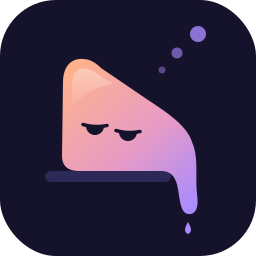

<p align="center">
  
</p>

# Lazyfin

Lazyfin is one Jellyfin plugin that fixes parts of Jellyfin's user experience. Every enhancement is on as soon as Lazyfin is installed, so viewers get a good result without configuring anything.

Lazyfin is written so that any enhancement could later move into Jellyfin or Jellyfin Web with little rework.

## Install

Lazyfin supports Jellyfin 12.x.

1. In Jellyfin, open **Dashboard → Plugins → Repositories** and add this repository URL:

   ```text
   https://osamahaltassan.github.io/lazyfin/manifest.json
   ```

2. Open **Catalog**, pick **Lazyfin**, and install it.
3. Restart Jellyfin.

## Enhancements

- **RTL fix**: right-to-left subtitle lines, such as Arabic or Hebrew, show their end punctuation at the end of the line, the way mpv shows them.
- **Unlimited Continue Watching and Next Up**: both rows list everything a viewer started, however long ago, in every client.
- **Watched items in Latest**: new viewers keep watched items in the home screen's Latest rows.

## Development

See [docs/development.md](docs/development.md).

## License

GPL-2.0. See [LICENSE](LICENSE).
