# Do the embedding marks put RTL end punctuation at the end in Safari and burn-in?

Proof for LAZ-6, under the spec LAZ-19, part of the map LAZ-2. The tickets live in the project's Kaneo tracker. This branch is never merged.

> *This was generated by AI during a wayfinder session.*

## Versions

| Part | Version |
| --- | --- |
| macOS | 26.7.1 (25G241), Apple silicon |
| jellyfin-ffmpeg | 8.1.3-1, `portable_macarm64-gpl`, the build `scripts/dev.sh` pins for both test servers (`ffmpeg version 8.1.3-Jellyfin`) |
| libass inside it | API `0x1705000`, commit `4a05d812`, CoreText font provider |
| Burn-in font | Arial, `/System/Library/Fonts/Supplemental/Arial.ttf` (`ArialMT`), picked by libass for ffmpeg's default SRT style. No font option was needed: Arabic and Hebrew drew as real letters on the first run. For the italic case libass picks `Arial Italic.ttf` and falls back to `Arial.ttf` for the Arabic letters, and slants them. |
| Safari | 27.0 (21625.1.29.18.28), WebKit `605.1.15`, the Safari that ships with macOS 26.7.1 |
| Jellyfin Web | `normalizeTrackEventText` copied byte for byte from `src/plugins/htmlVideoPlayer/plugin.js` at commit `0c363cbd0a0dede089cb6b7ddb1cb230c0a82479`, which matches `v12.2` |
| Chromium baseline | The Claude desktop app's built-in browser, Chrome `152.0.7977.167` |

## Results

| Renderer | Plain copy shows the bug | Result | Screenshots |
| --- | --- | --- | --- |
| Burn-in, jellyfin-ffmpeg `subtitles` filter | Yes, in every RTL case | **Pass**, all 10 cases | [burn-in/](embedding-marks-proof/burn-in/) |
| Safari, Jellyfin Web's custom element path | Yes, in every RTL case | **Pass**, all 9 cases | [safari-page/custom/](embedding-marks-proof/safari-page/custom/) |
| Safari, Jellyfin Web's native `VTTCue` path | Yes, in every RTL case | **Pass**, all 9 cases | [safari-page/native/](embedding-marks-proof/safari-page/native/) |
| Chromium baseline, both paths | Yes, in every RTL case | **Pass**, all 9 cases on both paths | [chromium-page/](embedding-marks-proof/chromium-page/) |
| Safari native HLS, WebVTT rendition, a stand-in for the iOS app's native player | Yes, in every RTL case | **Pass**, all 9 cases | [safari-hls/](embedding-marks-proof/safari-hls/) |

## The sample

[`make_sample.py`](embedding-marks-proof/make_sample.py) holds every case once and writes the two copies, [`sample/plain.srt`](embedding-marks-proof/sample/plain.srt) and [`sample/marked.srt`](embedding-marks-proof/sample/marked.srt). Both are UTF-8 with no byte order mark and LF line endings. It also writes [`sample/cues.json`](embedding-marks-proof/sample/cues.json), the cue text the Safari page reads: every case but `10-an8`, lines joined by LF, the way a Jellyfin `TrackEvent.Text` reaches Jellyfin Web. And it writes one local HLS stream per copy, [`hls/plain/`](embedding-marks-proof/hls/plain/) and [`hls/marked/`](embedding-marks-proof/hls/marked/), whose `subtitles.vtt` holds the same nine cases as WebVTT.

The marked copy puts RLE (U+202B) right after a line's leading markup and PDF (U+202C) right before its trailing markup: `<i>` + RLE + text + PDF + `</i>`, and `{\an8}` + RLE + text + PDF. Only lines whose first strong letter is right-to-left carry them. The two English lines are the same bytes in both copies. A byte check of both files confirmed all three rules.

| Case | Plain line |
| --- | --- |
| 01 Arabic, period | `وصلنا إلى المدينة في الصباح.` |
| 02 Arabic, exclamation mark | `هذا رائع جدًا!` |
| 03 Arabic, closing quote | `قالت لي: "لا تتأخر"` |
| 04 Arabic quoting an English name | `شاهدنا فيلم "The Matrix" أمس.` |
| 05 Arabic starting with digits | `20 دقيقة فقط حتى نهاية الفيلم` |
| 06 English with an Arabic word, unmarked | `The Arabic word مرحبا means hello.` |
| 07 Two lines, Arabic then English | `المفتاح على الطاولة.` / `The key is on the table.` |
| 08 Italic Arabic | `<i>كان ذلك مجرد حلم.</i>` |
| 09 Hebrew, period | `שלום לכולם.` |
| 10 Arabic with `{\an8}`, burn-in only | `{\an8}هذه الجملة في أعلى الشاشة.` |

## Burn-in

[`render_burn_in.sh`](embedding-marks-proof/render_burn_in.sh) runs it again. It draws each copy onto a blank 1280x720 video with `subtitles=f='<copy>.srt'`, with no `charenc` and no font option, the way the burn-in hook will hand ffmpeg its UTF-8 copy, and grabs one frame in the middle of each cue. Each screenshot below shows the plain copy on top and the marked copy below, from the same ffmpeg.

### What the plain copy shows

libass lays out every SRT line left to right, so the plain copy shows the bug in every RTL case: the period, exclamation mark, and closing quote sit at the right end, which is where an RTL reader starts. In case 04 the reading order breaks too: read from the right, the line starts with the period, then `أمس`, then `"The Matrix"`, then `شاهدنا فيلم`. In case 05 the digits sit at the left end.

### What the marked copy shows

| Case | Marked copy | Verdict |
| --- | --- | --- |
| 01 period | Period at the left end | Pass |
| 02 exclamation | `!` at the left end | Pass |
| 03 closing quote | Closing `"` at the left end, the quote reads in order | Pass |
| 04 English name | Reads `شاهدنا فيلم "The Matrix" أمس.` from the right, name intact, period at the left end | Pass |
| 05 leading digits | `20` stays at the right end, where the line starts | Pass |
| 06 English with Arabic word | Same as the plain copy | Pass |
| 07 two lines | Arabic line has its period at the left end; English line same as plain | Pass |
| 08 italic | Still italic, period at the left end | Pass |
| 09 Hebrew | Period at the left end | Pass |
| 10 `{\an8}` | Still at the top of the screen, period at the left end | Pass |

Nothing visible sits where the marks are: no box and no gap. Measured on the raw frames, the text's ink is the same width in both copies to within 3 pixels in every case but the italic one, and each line stays centred at the same height. The italic line is 9 pixels wider marked, because a slanted letter overhangs the period when it sits on the right, and covers less of it when it sits on the left. The zoomed frames show no gap.

### Screenshots

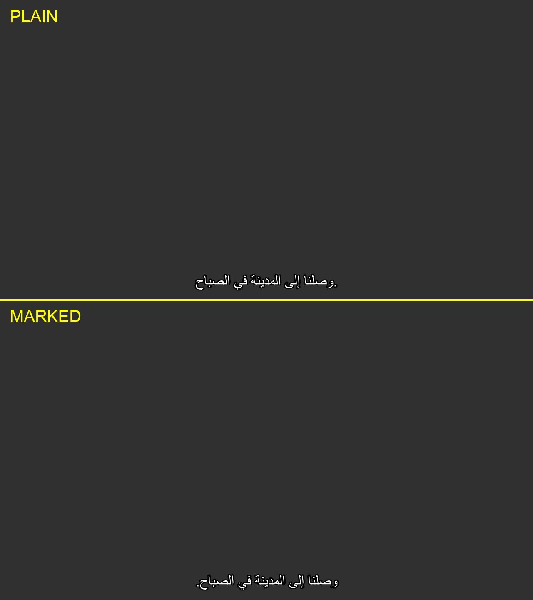
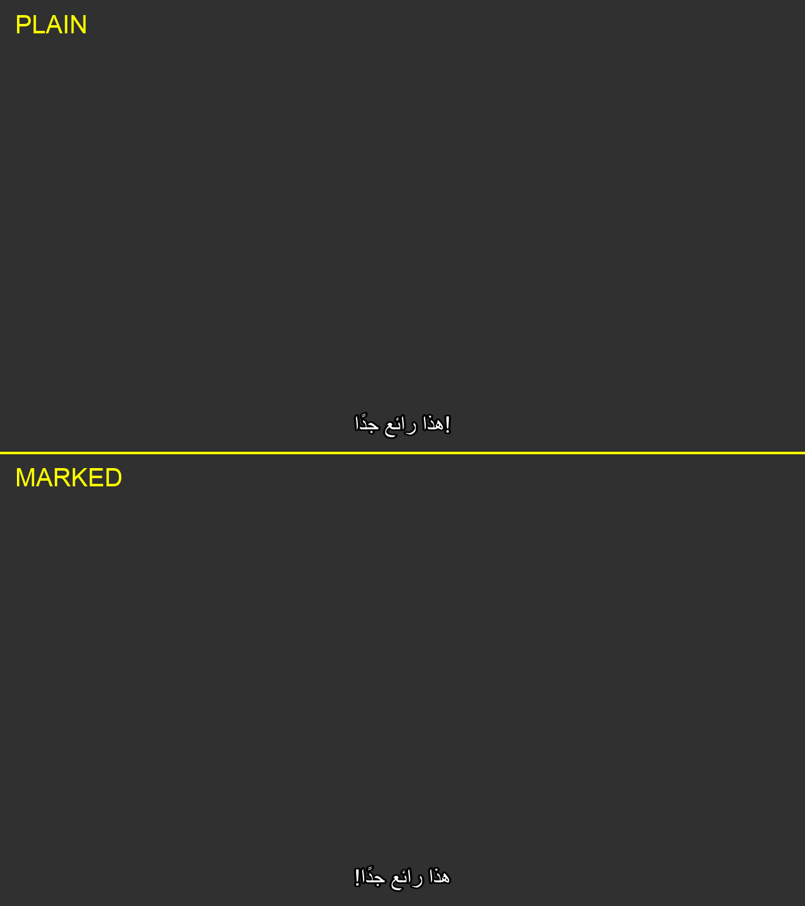
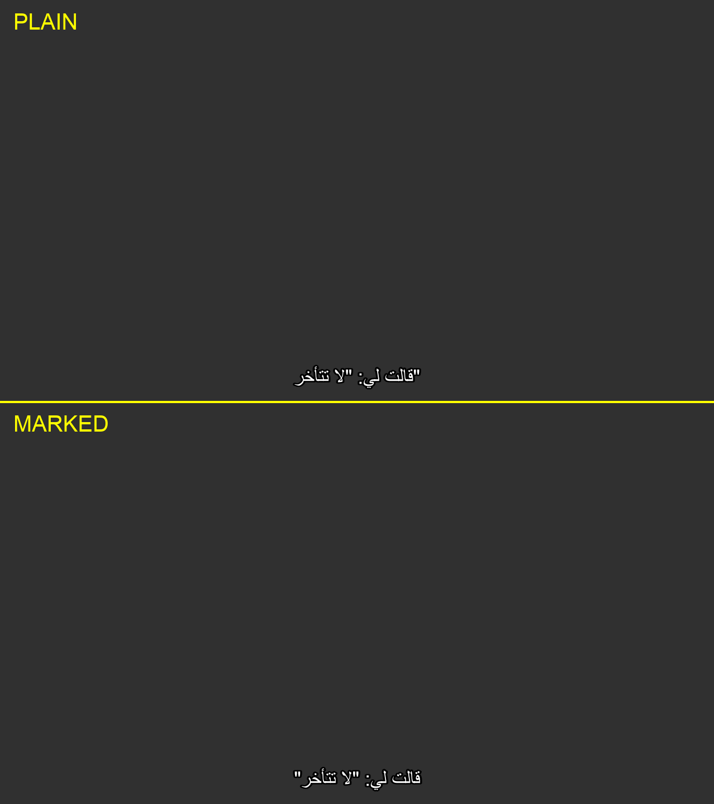
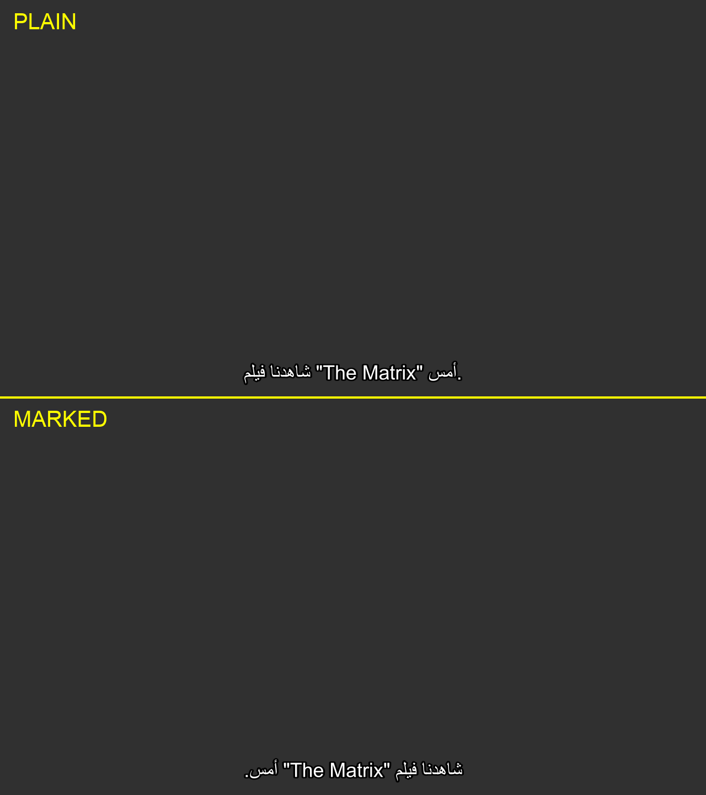
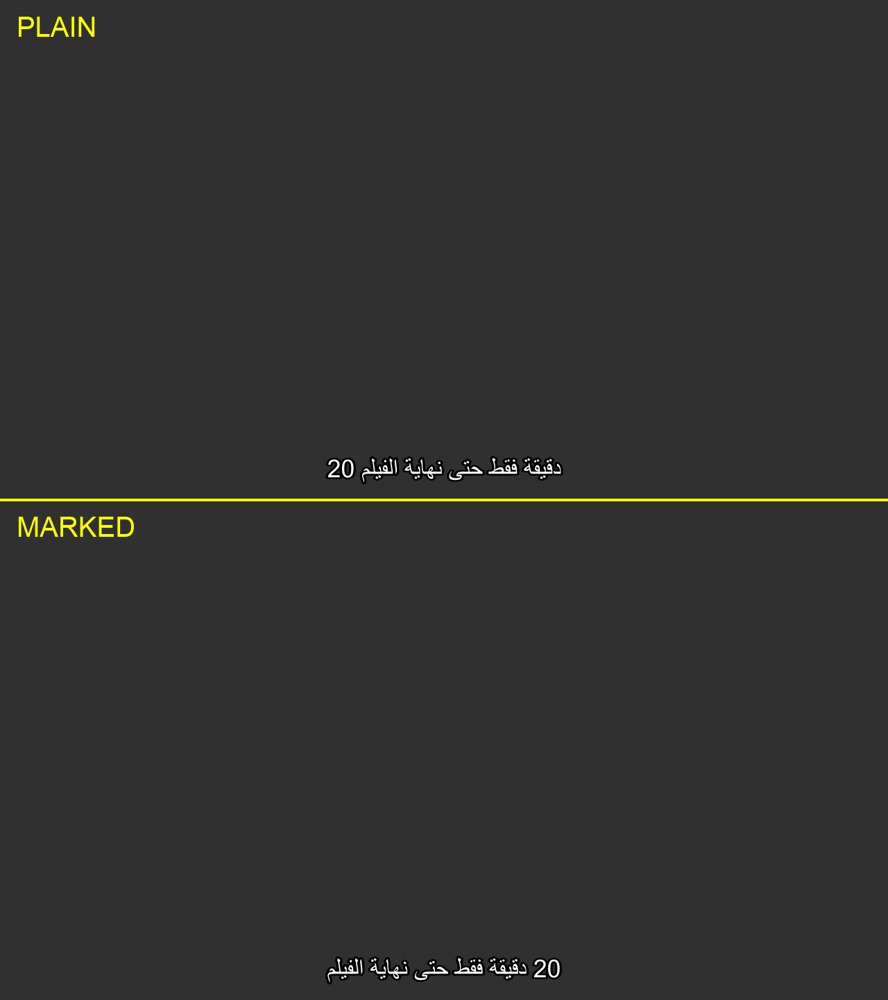
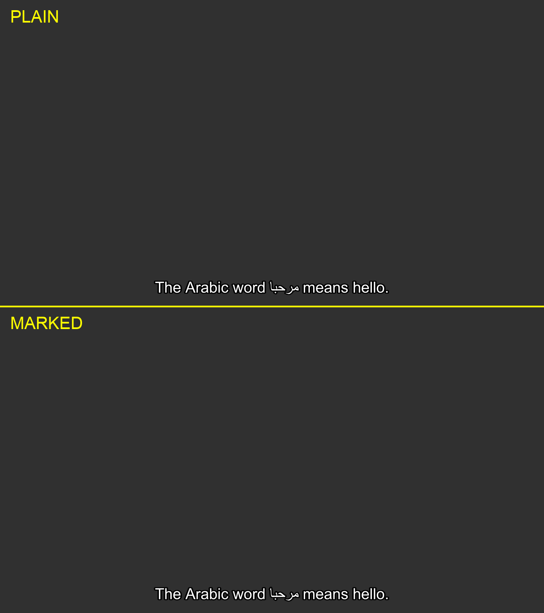
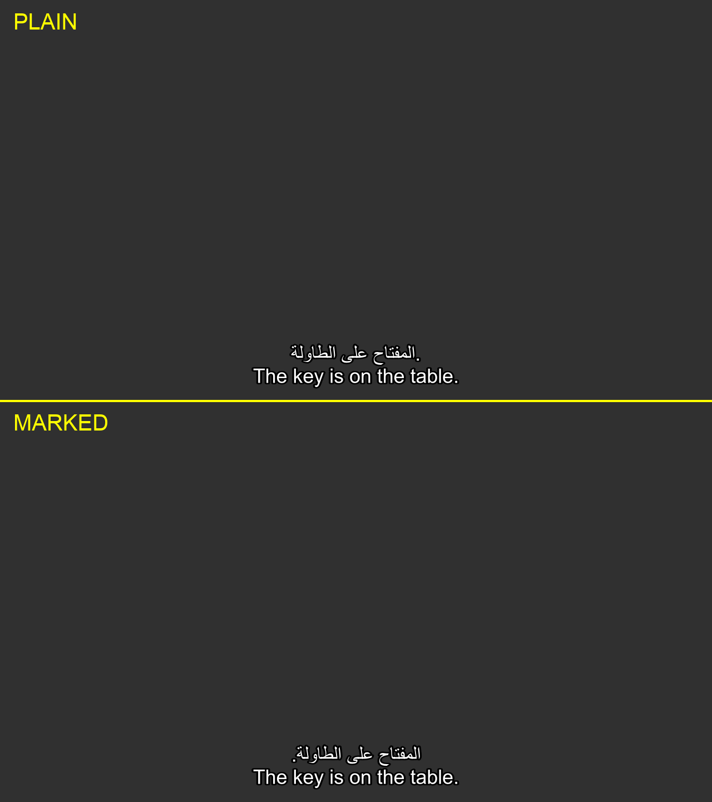
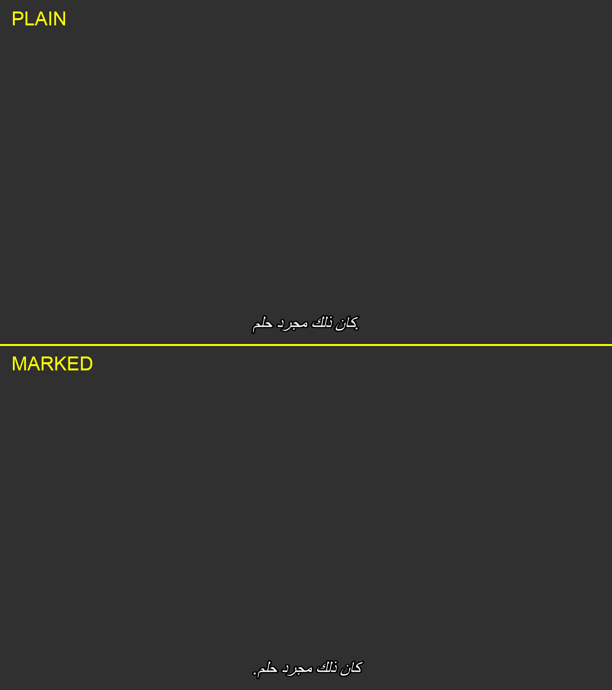

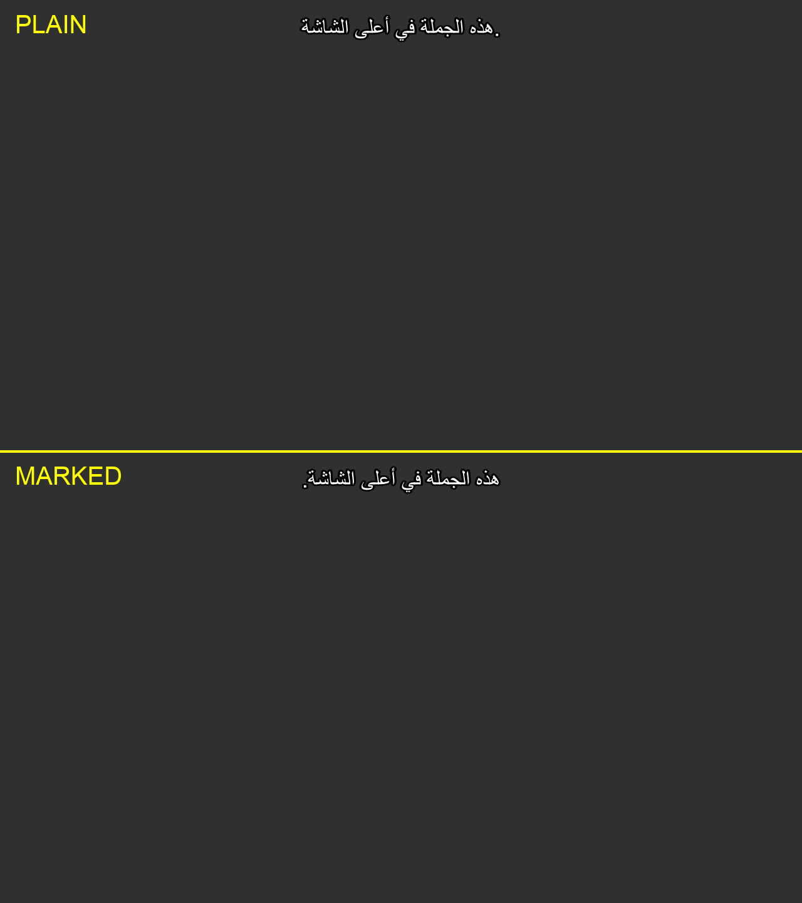

## Safari, Jellyfin Web's two paths

[`page/index.html`](embedding-marks-proof/page/index.html) holds a byte-for-byte copy of `normalizeTrackEventText` from Jellyfin Web commit `0c363cbd`, which adds a left-to-right mark (U+200E) to the start of every line. It shows one case at a time through one of Jellyfin Web's two text subtitle paths, the plain copy above the marked copy, both inside a `dir="ltr"` container, as the player's `videoPlayerContainer` is:

- **Custom element path:** `normalizeTrackEventText(text, true)` through `innerHTML` into `.videoSubtitlesInner`, with Jellyfin Web's own `.videoSubtitles` styles, the way `updateSubtitleText` does it. DOMPurify is skipped, because it removes markup and leaves bidi characters alone.
- **Native path:** a track from `addTextTrack('subtitles', 'manualTrack', 'und')` with one `VTTCue` per case from `normalizeTrackEventText(text, false)`, added before the track is set to `showing`, the way `setTrackForDisplay` does it. The video is a blank 640x360 H.264 file made by the test servers' jellyfin-ffmpeg, paused 0.75 seconds into the cue.

### How it ran

[`drive_safari.py`](embedding-marks-proof/drive_safari.py) `serve` regenerates the sample, makes the video under `.temp/embedding-marks-proof/page/`, and serves this folder on `127.0.0.1:8765` with Python's built-in HTTP server, plus the byte ranges Safari asks for on the video.

1. **Chromium baseline first.** The agent opened the page in the built-in browser and called `proof.show(path, case)` for every case on both paths. All 18 passed, so the page is right.
2. **Safari by hand.** The ticket planned to drive Safari through `safaridriver`'s WebDriver API, after the maintainer ran `safaridriver --enable`. The maintainer chose to keep Safari's remote automation off. Instead, the maintainer opened `http://127.0.0.1:8765/page/?step` in Safari, which steps through all 18 views with the right arrow key, and took one window screenshot per step. Each screenshot shows Safari's user agent under the title. The script's `shoot` mode, which drives Safari through WebDriver, stays on the branch for a later rerun, but it has never run against Safari.

No package was added: the page is plain HTML and JavaScript, and the script uses only Python's standard library.

### What the plain copy shows

Safari shows the bug on both paths, in every RTL case, exactly as Chromium does: the period, exclamation mark, and closing quote sit at the right end of the line. In case 04 the reading order breaks, with the period at the right, then `أمس`, then `"The Matrix"`, then `شاهدنا فيلم`. In case 05 the digits sit at the left end.

On the native path this matters: WebVTT asks a renderer to pick each cue's direction from its text, which on its own would lay these lines out right to left. Jellyfin Web's left-to-right mark comes first, so Safari picks left to right, and the native path shows the bug too.

### What the marked copy shows

Both paths look the same in Safari, so one table covers both.

| Case | Marked copy, both paths | Verdict |
| --- | --- | --- |
| 01 period | Period at the left end | Pass |
| 02 exclamation | `!` at the left end | Pass |
| 03 closing quote | Closing `"` at the left end, the quote reads in order | Pass |
| 04 English name | Reads `شاهدنا فيلم "The Matrix" أمس.` from the right, name intact, period at the left end | Pass |
| 05 leading digits | `20` at the right end, where the line starts | Pass |
| 06 English with Arabic word | Same as the plain copy | Pass |
| 07 two lines | Arabic line has its period at the left end; English line same as plain | Pass |
| 08 italic | Still italic, period at the left end | Pass |
| 09 Hebrew | Period at the left end | Pass |

Nothing visible sits where the marks are: no box and no gap. Each marked line has the same width and centre as its plain line, on the custom element's black box and on the native cue alike. The embedding marks override Jellyfin Web's left-to-right mark on both paths, so the delivery hook does not need Jellyfin Web to change.

### Screenshots

Each screenshot shows the plain copy on top and the marked copy below.

**Safari, custom element path**

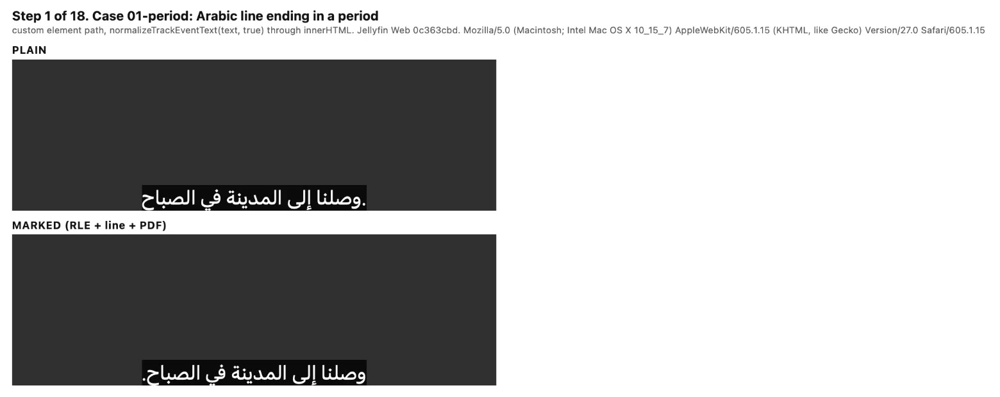

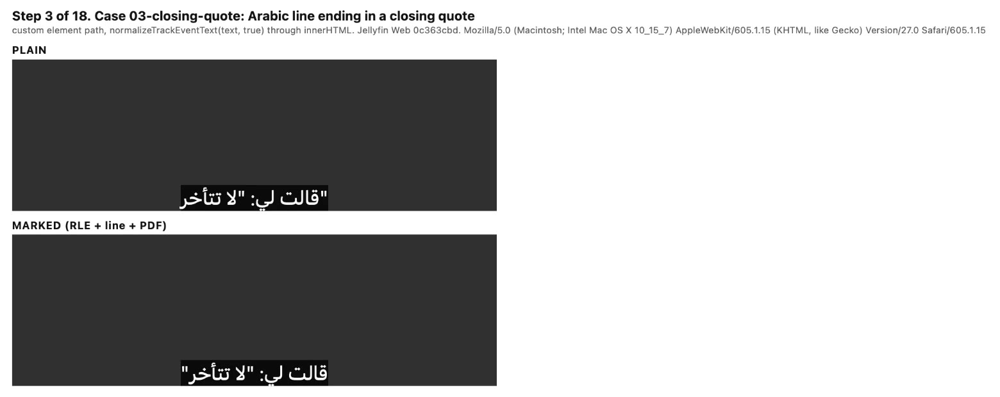
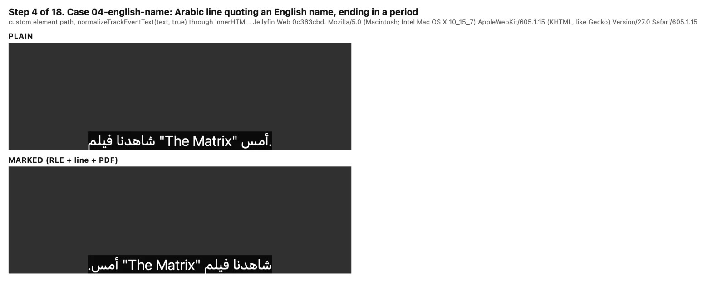
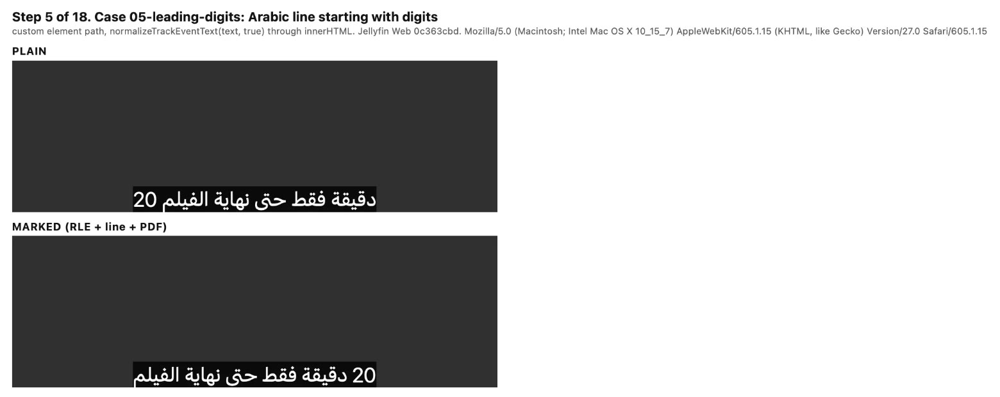
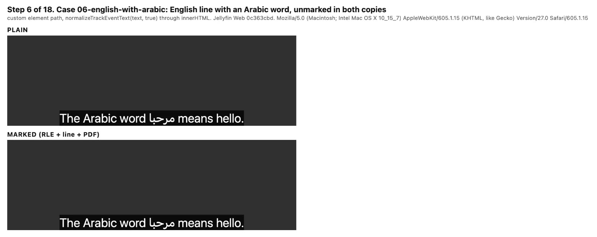

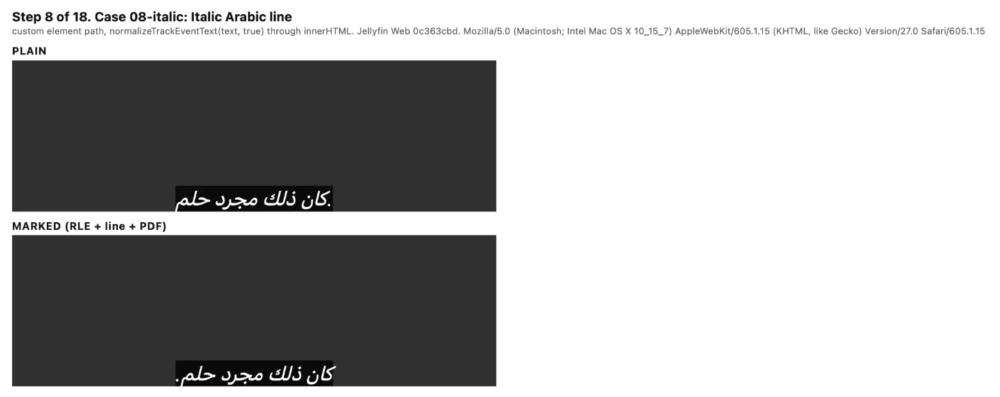

**Safari, native `VTTCue` path**

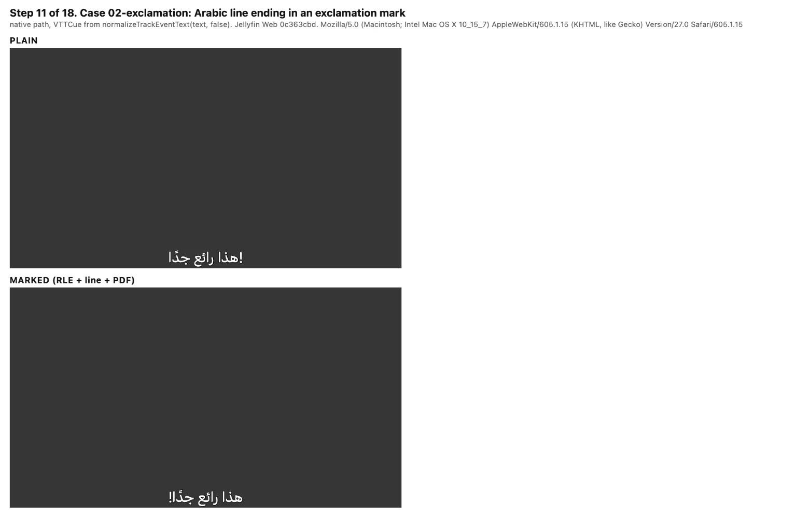
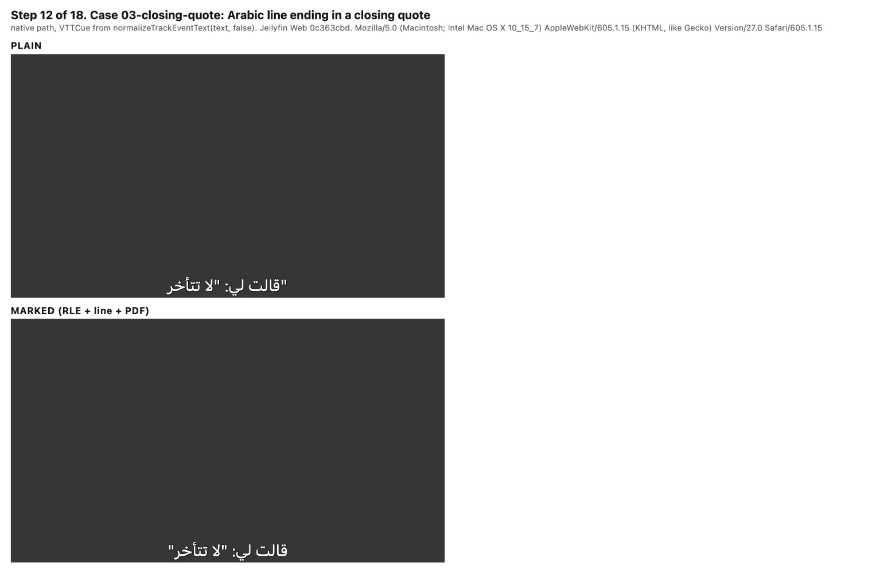
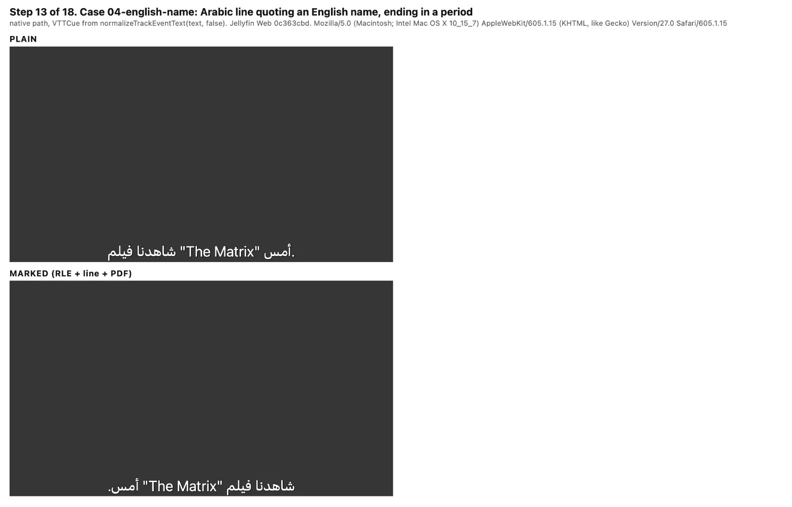
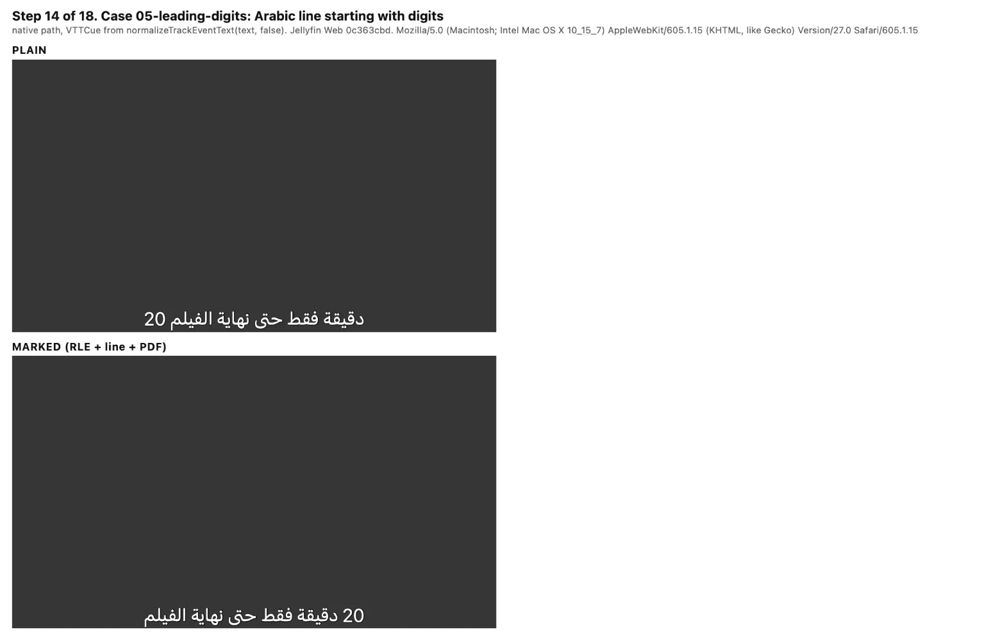

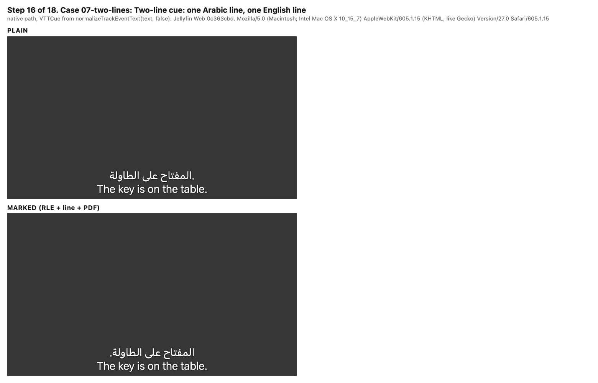
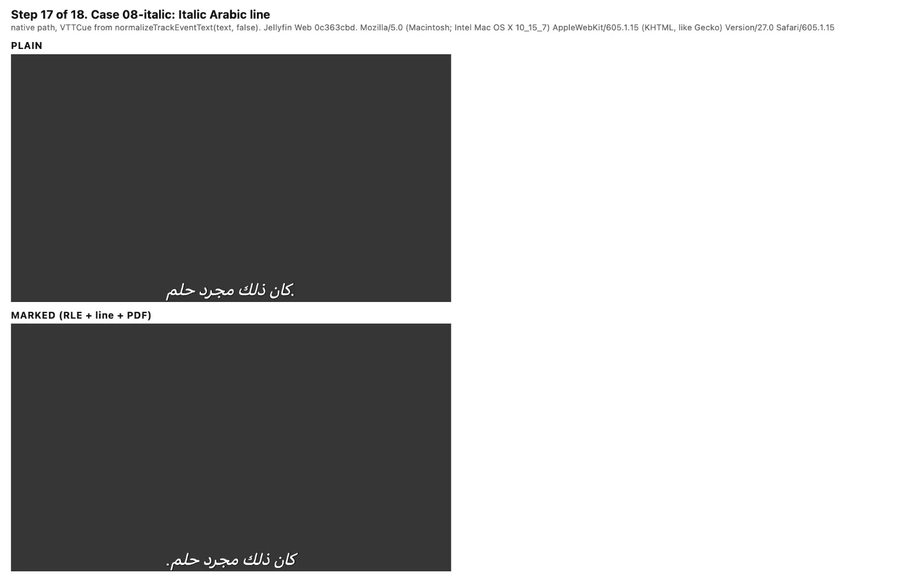

The Chromium baseline screenshots, same layout, are in [`chromium-page/custom/`](embedding-marks-proof/chromium-page/custom/) and [`chromium-page/native/`](embedding-marks-proof/chromium-page/native/).

## Safari native HLS

This checks whether Apple's own player honors the marks in a WebVTT track over HLS. **It is a stand-in for the iOS app's native player, not the same renderer.** Safari on a Mac draws in-page HLS subtitles through WebKit, while the iOS app's native player in full screen draws them with AVFoundation. The check on a real iPad settles that.

### The streams

There are two streams, one per copy, so the plain and marked tracks never mix. [`make_sample.py`](embedding-marks-proof/make_sample.py) writes each one's text files:

- `master.m3u8` names `subtitles.m3u8` as a WebVTT subtitle rendition with `DEFAULT=YES` and `AUTOSELECT=YES`, in the line shape Jellyfin's `DynamicHlsHelper` writes, with `LANGUAGE="ara"`. Its video variant is `../video/main.m3u8`.
- `subtitles.m3u8` lists one 22-second segment, `subtitles.vtt`.
- `subtitles.vtt` starts with `WEBVTT`, then `X-TIMESTAMP-MAP=MPEGTS:900000,LOCAL:00:00:00.000`, as Jellyfin's 12.x HLS subtitle segments do. It holds the nine cases at the same times as the page, UTF-8 with no byte order mark. No left-to-right mark is added: Jellyfin Web never touches HLS subtitles, and the iOS native player gets the server's WebVTT as it is.

[`drive_safari.py`](embedding-marks-proof/drive_safari.py) makes the video with the test servers' jellyfin-ffmpeg: a blank 640x360 H.264 video in four MPEG-TS segments, under `.temp/embedding-marks-proof/page/hls-video/`, served at `/hls/video/`. Its first PTS is 900000, the 10 seconds Jellyfin's MPEG-TS segments start at, so the timestamp map puts each cue at its own time. `ffprobe` confirmed the first PTS of each segment: 900000, 1440000, 1980000, 2520000.

### How it ran

The page's `hls` path plays each stream in a plain `<video>` element whose `src` is the stream's `master.m3u8`. No JavaScript player is involved, so Safari's own HLS player decodes both the video and the subtitles. The page only seeks and pauses. It turns the subtitle track on if Safari has not already, seeks 0.75 seconds into each cue, pauses, and prints under each copy the active cue as Safari parsed it, with its times and the marks spelled out as `[RLE]` and `[PDF]`.

The maintainer kept Safari's remote automation off again, so the script's WebDriver mode did not run. The maintainer opened `http://127.0.0.1:8765/page/?step=hls` in Safari and took one window screenshot per case, 9 in all. The agent checked each one, zoomed in on both subtitles.

Every screenshot's cue line confirms the stream itself was read right:

- Safari picked the track on its own. Its mode was already `showing` before the page touched it, so `DEFAULT=YES` and `AUTOSELECT=YES` worked.
- Each active cue is a `VTTCue` that starts and ends at the sample's times, such as 2.000 to 3.500 seconds for case 01, so the timestamp map lined up.
- Each cue's text is the same as the sample, marks included. Safari kept RLE and PDF through the HLS and WebVTT parsers.

Chromium is no baseline here. The built-in browser, Chrome 152, plays the HLS video natively but exposes no text track for the WebVTT rendition and draws no subtitle. The plain copy, rendered by the same Safari player, is the control.

### What the plain copy shows

Safari's HLS player shows the bug in every RTL case, even though no left-to-right mark is added on this path: the period, exclamation mark, and closing quote sit at the right end of the line. In case 04 the reading order breaks, with the period at the right, then `أمس`, then `"The Matrix"`, then `شاهدنا فيلم`. In case 05 the digits sit at the left end. So Safari does not pick a cue's direction from its text, and the RTL fix is needed on this path too.

### What the marked copy shows

| Case | Marked copy | Verdict |
| --- | --- | --- |
| 01 period | Period at the left end | Pass |
| 02 exclamation | `!` at the left end | Pass |
| 03 closing quote | Closing `"` at the left end, the quote reads in order | Pass |
| 04 English name | Reads `شاهدنا فيلم "The Matrix" أمس.` from the right, name intact, period at the left end | Pass |
| 05 leading digits | `20` at the right end, where the line starts | Pass |
| 06 English with Arabic word | Same as the plain copy | Pass |
| 07 two lines | Arabic line has its period at the left end; English line same as plain | Pass |
| 08 italic | Still italic, period at the left end | Pass |
| 09 Hebrew | Period at the left end | Pass |

Nothing visible sits where the marks are: no box and no gap. Each marked line has the same width and centre as its plain line, on the same black cue box.

### Screenshots

Each screenshot shows the plain stream on top and the marked stream below, each with its cue line under it. The raw screenshots, as the maintainer pasted them, stay in `.temp/embedding-marks-proof/safari-hls-manual/`.

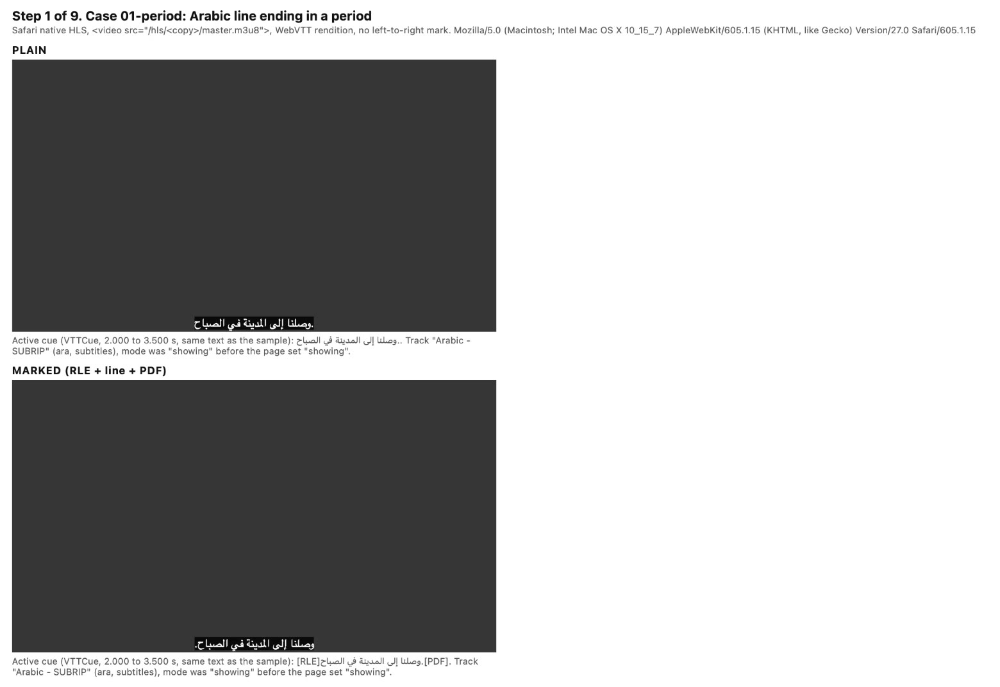
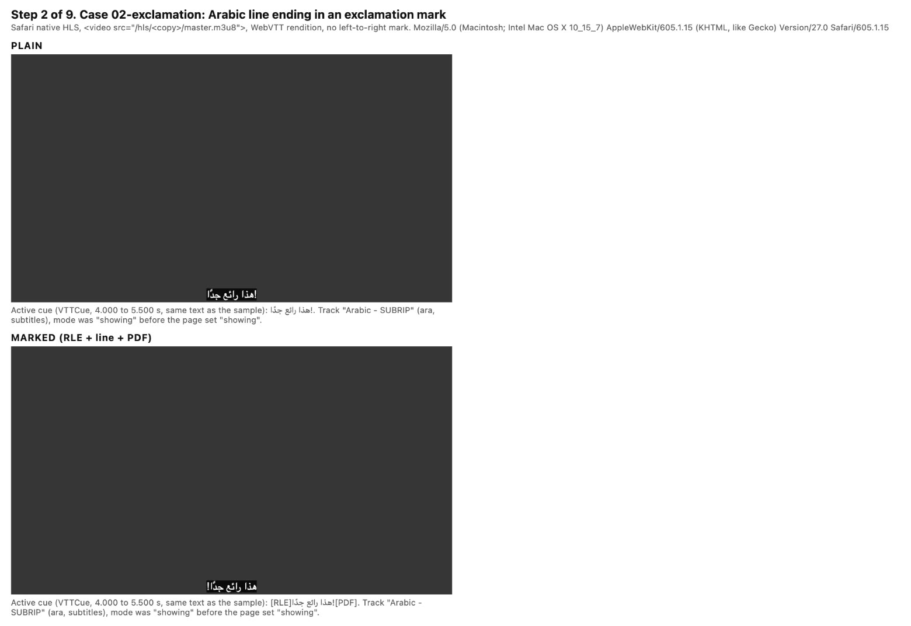

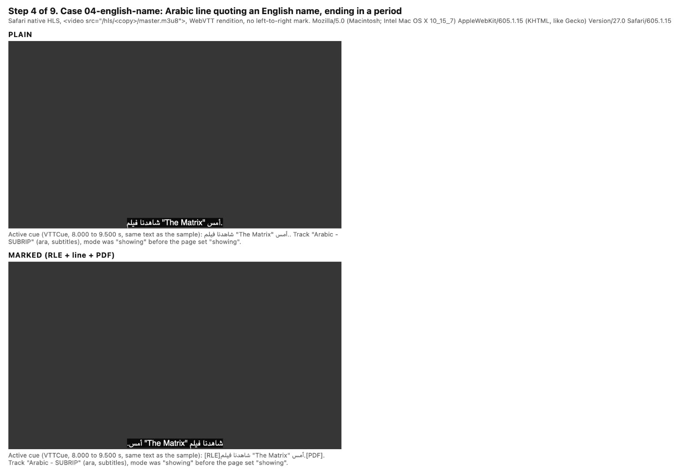
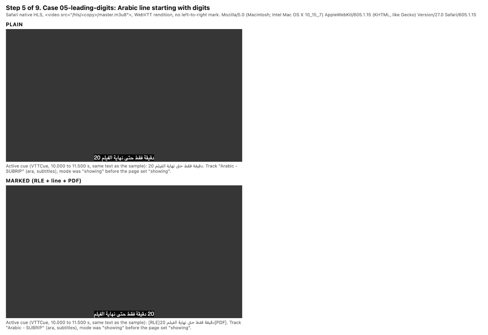
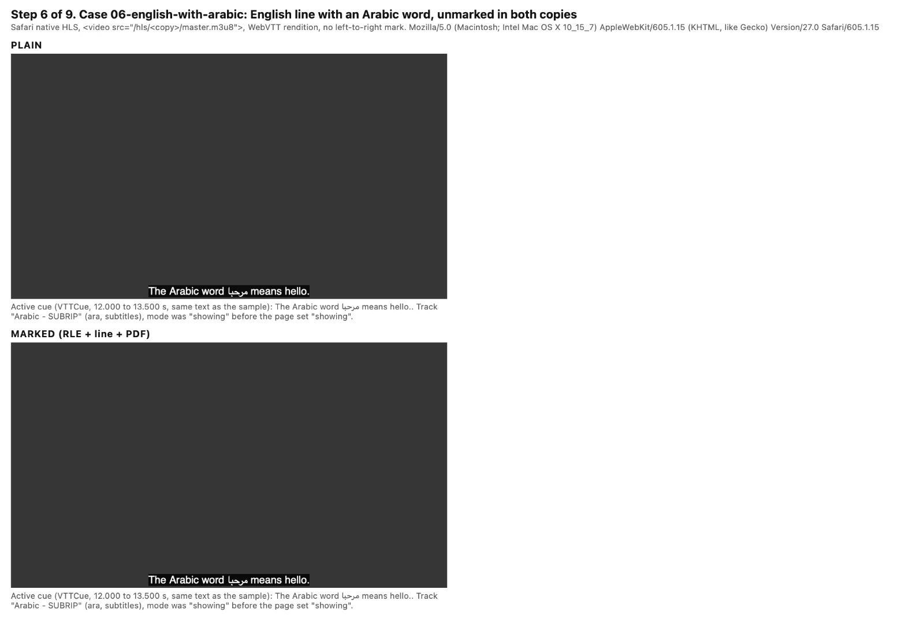
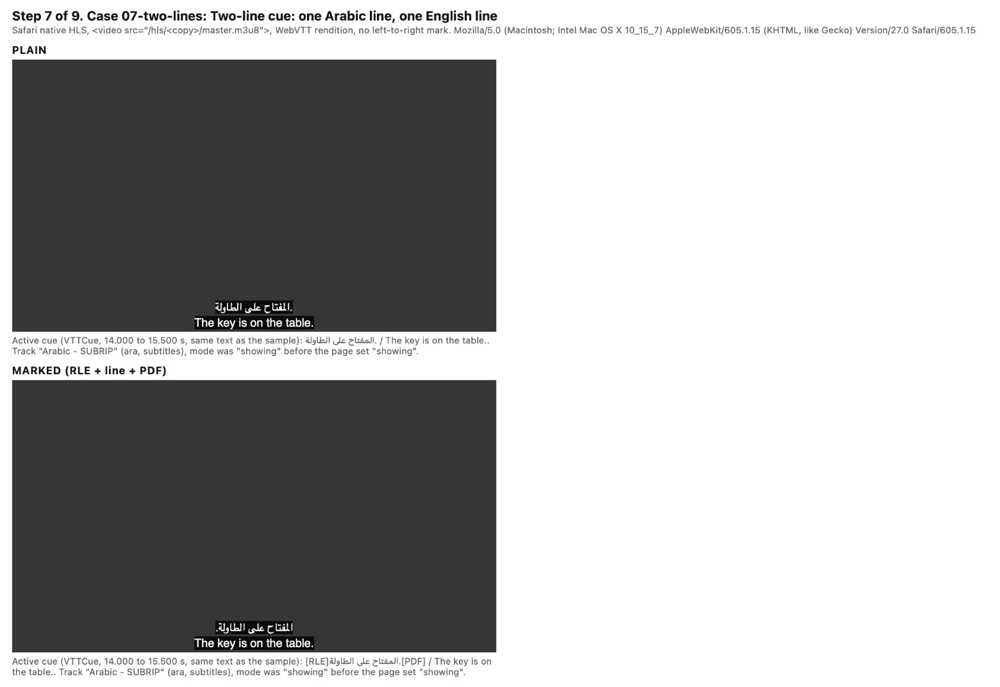
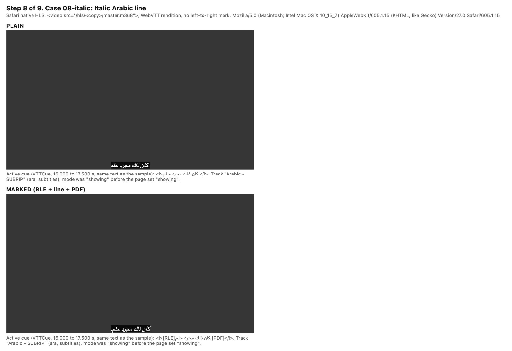
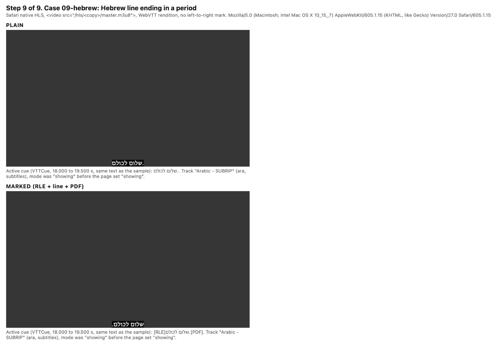
