# Verifying the RTL fix on the 12.2 and 13.0 test servers

Evidence for the check that the RTL fix works end to end on the local 12.2 and 13.0 test servers from `scripts/dev.sh`, with a control run without Lazyfin beside a fix run with it. This branch is never merged.

This file holds the subtitle bytes, the web player in Safari and in the built-in browser, and burn-in.

## Versions

| What | Version |
| --- | --- |
| macOS | 26.7.1 (25G241), Apple silicon |
| Safari | 27.0 (21625.1.29.18.28), driven through `safaridriver` and the W3C WebDriver API |
| Built-in browser | The Claude desktop app's browser pane (`Claude/3.6556.2` in its user agent), Chromium `152.0.7977.167`, driven through the app's browser tools |
| Server 12.2 | Jellyfin 12.2.0, `jellyfin_12.2-arm64.tar.xz` from the stable macOS builds |
| Server 13.0 | Jellyfin 13.0.0, unstable build `2026101212`, `jellyfin_2026101212-arm64.tar.xz` |
| jellyfin-ffmpeg | 8.1.3-1, `portable_macarm64-gpl`, the build `scripts/dev.sh` pins (`ffmpeg version 8.1.3-Jellyfin`), libass API `0x1705000`, commit `4a05d812`, CoreText font provider |
| Lazyfin | `main` at `eefc2b2` ("Fix RTL lines in burned-in video"), installed as 0.0.1.0 by `scripts/dev.sh release` through a local plugin repository |
| Burn-in font | Arial, `/System/Library/Fonts/Supplemental/Arial.ttf` (`ArialMT`), and `Arial Italic.ttf` for the italic line, picked by libass for the server's default style. |
| Fallback font | `Arial.ttf`, a copy of the same Arial file, in `.temp/rtl-check/fonts`, set as each server's fallback font folder from the Safari check on. Jellyfin Web hands it to SubtitlesOctopus, its ASS renderer. Burn-in does not get it: its `fontsdir` is the movie's empty attachments folder. |

## The test library

[`make_library.py`](rtl-fix-verification/make_library.py) writes the [sample](rtl-fix-verification/sample/) and builds the library in `.temp/rtl-check/library`, on the 10-second `testsrc` test video from the ffmpeg ticket. Both servers have it as their one `Movies` library and read the same files.

| Movie | Subtitles |
| --- | --- |
| Lazyfin RTL External (2026) | MP4, with [`arabic.srt`](rtl-fix-verification/sample/arabic.srt) next to it as `.ar.srt` and [`english.srt`](rtl-fix-verification/sample/english.srt) as `.en.srt` |
| Lazyfin RTL Embedded (2026) | MKV with `arabic.srt` (stream 2) and [`arabic.ass`](rtl-fix-verification/sample/arabic.ass) (stream 3) muxed in, both tagged `ara` |
| Lazyfin RTL Uploaded (2026) | MP4 alone. `arabic.srt` was uploaded through Jellyfin Web's subtitle upload dialog in the control run. |
| Lazyfin RTL Windows-1256 (2026) | MP4, with [`arabic-windows-1256.srt`](rtl-fix-verification/sample/arabic-windows-1256.srt) next to it as `.ar.srt`, for burn-in |

Every Arabic SRT holds the same two cues:

- **Cue 1, 1.0 s to 4.5 s:** an Arabic line ending in a period, an Arabic line quoting "The Matrix" and ending in `!`, the English line `The Arabic word مرحبا means hello.`, and an italic Arabic line ending in a period.
- **Cue 2, 5.5 s to 9.0 s:** `{\an8}` and an Arabic line ending in a period.

The English SRT has two English cues at the same times. The ASS track has two `Dialogue` lines at the same times, with the period at the start of each Arabic line, where ASS authors put it for the VSFilter rule. Every SRT but the Windows-1256 one is UTF-8 with no byte order mark and LF line endings.

The test video is 10 seconds, not the 15 the spec guessed. Both cues fit in it with a gap between them.

## Server settings

Both servers keep their defaults, apart from the library:

- One `Movies` library at `.temp/rtl-check/library`, with "Save subtitles with media" on, the default, so an upload lands next to the video.
- Fallback fonts were off for the bytes check. The burn-in proof needed no font for Arabic, and one burned-in control frame per server confirms Arabic draws as letters, not boxes. See [Burn-in font check](#burn-in-font-check).
- Fallback fonts are on from the Safari check on, with `.temp/rtl-check/fonts` holding only `Arial.ttf`. Without a fallback font, Jellyfin Web's ASS renderer, SubtitlesOctopus, has no Arabic font, and the ASS track drew every Arabic letter as a box in a trial run. A screenshot with boxes is never a result, so this was set through the API on both servers before the Safari control run, and stays on for the later checks.
- The maintainer counts the bytes check as run with the same settings: in Jellyfin, fallback fonts only feed the web player's font list and font downloads, never the subtitle bytes the server hands out.
- The test admin's subtitle settings stay at their defaults, apart from Burn subtitles in the burn-in check. Jellyfin Web keeps that setting in the browser per server, not on the server. The burn-in check set it to All in the built-in browser on both servers before its control run, and back to Auto after its fix run. Saving the page also wrote `alwaysBurnInSubtitleWhenTranscoding=false`, which is the default.
- The other encoding settings are the defaults, as the burn-in check read them: no hardware acceleration, encoder preset `auto`, H.264 CRF 23, and subtitle extraction on.

## The runs

**Control run.** Lazyfin 0.0.0.0 was uninstalled on each server through the Dashboard's plugin page, in the built-in browser, and both servers were restarted. `GET /Plugins` then listed AudioDB, ListenBrainz Similarity Provider, MusicBrainz, OMDb, Studio Images, and TMDb on both, and no Lazyfin.

**The upload.** In the bytes check, Safari would not start a WebDriver session. First it refused because remote automation was off. After the maintainer turned it on, Safari timed out creating the session. The maintainer turned remote automation off again and uploaded `arabic.srt` by hand on the 12.2 server: Jellyfin Web's subtitle editor, language Arabic, file picked in the dialog. The server saved it as `Lazyfin RTL Uploaded (2026).ara.srt`, byte for byte the same as `arabic.srt`.

The 13.0 server reads the same folder, so it got the same file through a metadata refresh of the item, not a second upload. A second upload would have saved a second file, `….ara.0.srt`, because Jellyfin's `SubtitleManager` never overwrites, and both servers would then have listed two Arabic subtitles. After the refresh, both servers list one Arabic external subtitle on the Uploaded movie.

**Fix run.** `scripts/dev.sh release` built the release zip and manifest the way CI does and installed Lazyfin through a local plugin repository. `GET /Plugins` then listed `Lazyfin 0.0.1.0 Active` on both servers.

## Subtitle bytes

[`check_bytes.py`](rtl-fix-verification/check_bytes.py) fetched, in each run and with the test admin's token, every text subtitle track as `Stream.js`, `Stream.vtt`, and `Stream.srt`, the ASS track as `Stream.ass` too, and the first segment of each track's HLS subtitle playlist, from a master playlist with `SubtitleMethod=Hls`. It judged them by the spec's rules:

- **Arabic SRT tracks:** in the fix run, each RTL line is wrapped in one RLE and one PDF, after its leading markup and before its trailing markup, and every other line has none. With every RLE and PDF removed, the fix output equals the control output. JSON is parsed before it is compared.
- **English and ASS tracks:** every form is byte for byte the same in both runs, the ASS track's HLS WebVTT segment included.
- **The Windows-1256 item** is for burn-in only, so its lines say Info and cannot fail. Both servers convert it to UTF-8 before they hand it out, so it comes out wrapped like the others.

Before trusting the judge, it was fed bad input on purpose: the control bytes as if they were the fix run, RLE moved before `<i>` or `{\an8}`, PDF moved after `</i>`, one Arabic line left unwrapped, the English line wrapped, and a changed letter. It failed each one.

What the fix run's HLS segment for the MKV's Arabic SRT track looks like, with the marks shown as `[RLE]` and `[PDF]`:

```text
WEBVTT
X-TIMESTAMP-MAP=MPEGTS:900000,LOCAL:00:00:00.000

00:00:01.023 --> 00:00:04.523
[RLE]وصلنا إلى المدينة في الصباح.[PDF]
[RLE]شاهدنا فيلم "The Matrix" أمس![PDF]
The Arabic word مرحبا means hello.
<i>[RLE]كان ذلك مجرد حلم.[PDF]</i>

00:00:05.523 --> 00:00:09.023 line:20%
[RLE]هذه الجملة في أعلى الشاشة.[PDF]
```

The 12.2 and 13.0 servers returned identical bytes for every file, in the control run and in the fix run.

## The web player in Safari

[`drive_safari.py`](rtl-fix-verification/drive_safari.py) drove Jellyfin Web in Safari through `safaridriver`. For each server and run, it opened one fresh WebDriver session, which starts with an empty cache and no sign-in, and signed in as the test admin through the login form. For each of the five tracks it opened the movie's details page, picked the track in its Subtitles menu, clicked Play, paused, and seeked to 2.5 s for cue 1 and 7.0 s for cue 2. It then hid the player's controls with a style rule, so they never cover a subtitle, and saved a screenshot cropped to the video picture, 960 pixels wide. Burn subtitles stayed at Auto, so text subtitles were delivered, not burned in.

Beside each screenshot the driver read what the page showed: the renderer, the subtitle text, and the RLE and PDF marks in it. That shows the fix run's screenshots came from the marked subtitles, not from a cache.

- **Arabic and English SRT tracks:** Jellyfin Web draws them with its custom subtitle element, from `Stream.js`. The MP4s play directly, and the MKV plays as an HLS remux. In the fix run the element held 3 RLE and 3 PDF on cue 1 and 1 of each on cue 2, on every Arabic track. In the control run it held none, and the English track held none in either run.
- **Arabic ASS track:** SubtitlesOctopus draws it on a canvas, with the fallback font.

**Judging.** The English and ASS screenshots are pixel for pixel the same in both runs on both servers: ffmpeg's PSNR between control and fix is infinite. The External and Uploaded screenshots are pixel for pixel the same as each other, and the Embedded ones differ from them only in video decoding noise, at a PSNR above 52 dB. 12.2 and 13.0 gave pixel-identical screenshots for every track.

- **The control shows the bug** on every Arabic SRT track. The period sits at the right end of each Arabic line, where an Arabic reader starts. The "The Matrix" line reads in left-to-right order, with `!` at the right end. The italic line has its period at the right end.
- **The fix run** puts the period, the `!`, and the italic line's period at the left end of each Arabic line. The "The Matrix" line starts at the right with its first word, and the English name is whole and in order. The English line with مرحبا looks the same as in the control. Nothing shows where the marks sit: no box and no gap.
- **The `{\an8}` cue** shows at the bottom in both runs. Jellyfin Web's custom element ignores the position tag, with or without Lazyfin. Its period moves from the right end to the left end.
- **The ASS track** shows its period at the left end in both runs, where the ASS author put it.

## The web player in the built-in browser

The built-in browser has no WebDriver, so the agent drove it with the Claude desktop app's browser tools and the page helpers in [`browser_helpers.js`](rtl-fix-verification/browser_helpers.js). The browser was already signed in to both servers as the test admin. For each server and run, it loaded Jellyfin Web, emulated a 960 by 540 viewport so the 16:9 video fills the page, and, for each of the five tracks, opened the movie's details page, picked the track in its Subtitles menu, clicked Play, paused, and seeked to 2.5 s for cue 1 and 7.0 s for cue 2. It hid the player's controls with the same style rule as the Safari driver, and saved the pane's screenshot of the page, which is the whole video picture, as an 800 by 450 JPEG. Burn subtitles stayed at Auto: the browser had no saved burn-in setting.

The same browser profile ran both runs, so a cached subtitle could have carried over. Before judging any fix-run screenshot of an Arabic SRT track, the agent read the player's own `Stream.js` response for that track with the browser's network tool. In the fix run, every one held four RLE and four PDF, one pair around each Arabic line, and the English line held none. In the control run, none held a mark.

- **Arabic and English SRT tracks:** in Chromium, Jellyfin Web draws them as native text track cues on the video element, from `Stream.js`, not with the custom element Safari got. Jellyfin Web puts a left-to-right mark at the start of each cue line. All three movies play directly, the MKV included. In the fix run the cue text held 3 RLE and 3 PDF on cue 1 and 1 of each on cue 2, on every Arabic track. In the control run it held none, and the English track held none in either run.
- **Arabic ASS track:** SubtitlesOctopus draws it on its `libassjs-canvas`, with the fallback font, as in Safari.

**Judging.** The English and ASS screenshots are byte for byte the same files in both runs on both servers. The External and Uploaded screenshots are byte for byte the same as each other. The Embedded ones differ only in the video frame under the subtitle. 12.2 and 13.0 gave byte-identical screenshots for every track, in both runs.

- **The control shows the bug** on every Arabic SRT track, as in Safari. The period sits at the right end of each Arabic line. The "The Matrix" line reads in left-to-right order, with `!` at the right end. The italic line has its period at the right end.
- **The fix run** puts the period, the `!`, and the italic line's period at the left end of each Arabic line. The "The Matrix" line starts at the right with its first word, and the English name is whole and in order. The English line with مرحبا is pixel for pixel the same as in the control: ffmpeg's PSNR on that strip of the picture is infinite on every Arabic track and both servers. Nothing shows where the marks sit: no box and no gap.
- **The `{\an8}` cue** shows at the bottom in both runs. Jellyfin Web drops the position tag before it makes the native cue, with or without Lazyfin. Its period moves from the right end to the left end.
- **The ASS track** shows its period at the left end in both runs, where the ASS author put it.

## Burn-in

The burn-in check drove Jellyfin Web in the built-in browser, the way a viewer turns burn-in on. It set Burn subtitles to All on the subtitle settings page of each server, then ran a control run with Lazyfin uninstalled through the Dashboard and both servers restarted, and a fix run after `scripts/dev.sh release`. Fallback fonts stayed on, as in the Safari and built-in browser checks. It used the page helpers in [`browser_helpers.js`](rtl-fix-verification/browser_helpers.js), with the Windows-1256 movie (`b05cbdd8c44fc99abe3b2c176b024d13`, track 0) added by its id, the same 960 by 540 viewport, the same cue moments, 2.5 s and 7.0 s, and the same style rule that hides the player's controls.

For each of the six tracks, Jellyfin Web asked for an HLS transcode with `SubtitleMethod=Encode`, and the player played it through Media Source Extensions. No text track or subtitle element was on the page: the page helper reported no renderer, so the letters in the screenshots are in the video picture. After each play, [`burnin_filters.py`](rtl-fix-verification/burnin_filters.py) read the `subtitles=f='...'` filter from the newest transcode log, and opened Lazyfin's copy when the filter pointed at one. Each play wrote one transcode log.

- **Control run:** every Arabic SRT filter points at the original file next to the video, or at the server's extracted copy of the MKV track in its data folder. Jellyfin adds `:charenc=utf-8` for the UTF-8 files and `:charenc=windows-1256` for the Windows-1256 file. The English SRT gets `:charenc=ascii`.
- **Fix run:** every Arabic SRT filter, the Windows-1256 one included, points at a copy in `cache/lazyfin/rtl-fix` with no `:charenc=` after it. Each copy is strict UTF-8 with no byte order mark and holds 4 RLE and 4 PDF, one pair around each Arabic line. With the marks removed, the External, Uploaded, and Windows-1256 copies equal the UTF-8 sample, and the Embedded copy equals the server's extracted track. Both servers wrote the same copies byte for byte. The English and ASS filters are the same as in the control run.
- **The fallback font does not reach burn-in.** The filter's `fontsdir` is the movie's attachments folder, which is empty here, not the fallback font folder. libass draws the letters with Arial through its CoreText font provider, as in the font check below.

**Judging.** 12.2 and 13.0 gave byte-identical screenshots for every track, in both runs. The English and ASS screenshots are byte for byte the same files in both runs. The External, Uploaded, and Windows-1256 screenshots are byte for byte the same as each other in each run. The Embedded ones differ only in the video frame under the subtitle.

- **The control shows the bug** on every Arabic SRT track. The period sits at the right end of each Arabic line, where an Arabic reader starts. The "The Matrix" line reads in left-to-right order, with `!` at the right end. The italic line has its period at the right end.
- **The fix run** puts the period, the `!`, and the italic line's period at the left end of each Arabic line. The "The Matrix" line starts at the right with its first word, and the English name is whole and in order. Nothing shows where the marks sit: no box and no gap.
- **The English line with مرحبا** looks the same in both runs. The JPEG screenshots differ slightly on that line, because JPEG blocks cross into the Arabic lines next to it. So the agent also burned the original and the fixed copy of the External track into the same frame at 2.5 s with the servers' ffmpeg, losslessly at 1280 by 720. Only the rows of the Arabic lines differ, and the English line is pixel for pixel the same. In the [lossless comparison](rtl-fix-verification/burn-in/english-line-lossless.jpg), the control is on top, the fix in the middle, and their difference at the bottom.
- **The `{\an8}` cue** sits at the top in both runs, because libass reads the tag. Its period moves from the right end to the left end.
- **The ASS track** shows its period at the left end in both runs, where the ASS author put it.
- **Letters, not boxes:** every screenshot shows real Arabic letters, in both runs.

How to read the tables below: in each pair, the control is on the left and the fix on the right. Click a picture for the full size.

## 12.2

### Subtitle bytes

| Check | JSON | WebVTT | SRT | ASS | HLS segment |
| --- | --- | --- | --- | --- | --- |
| Bytes, External, Arabic SRT | Pass | Pass | Pass | | Pass |
| Bytes, External, English SRT | Pass | Pass | Pass | | Pass |
| Bytes, Embedded, Arabic SRT | Pass | Pass | Pass | | Pass |
| Bytes, Embedded, Arabic ASS | Pass | Pass | Pass | Pass | Pass |
| Bytes, Uploaded, Arabic SRT | Pass | Pass | Pass | | Pass |
| Bytes, Windows-1256, Arabic SRT | Info | Info | Info | | Info |

Script output:

```text
PASS 12.2  Embedded      2-ara-subrip   hls  4 of 4 RTL lines wrapped, 1 other lines unmarked
PASS 12.2  Embedded      2-ara-subrip   js   4 of 4 RTL lines wrapped, 1 other lines unmarked
PASS 12.2  Embedded      2-ara-subrip   srt  4 of 4 RTL lines wrapped, 1 other lines unmarked
PASS 12.2  Embedded      2-ara-subrip   vtt  4 of 4 RTL lines wrapped, 1 other lines unmarked
PASS 12.2  Embedded      3-ara-ass      ass  byte for byte the same as control
PASS 12.2  Embedded      3-ara-ass      hls  byte for byte the same as control
PASS 12.2  Embedded      3-ara-ass      js   byte for byte the same as control
PASS 12.2  Embedded      3-ara-ass      srt  byte for byte the same as control
PASS 12.2  Embedded      3-ara-ass      vtt  byte for byte the same as control
PASS 12.2  External      0-ara-subrip   hls  4 of 4 RTL lines wrapped, 1 other lines unmarked
PASS 12.2  External      0-ara-subrip   js   4 of 4 RTL lines wrapped, 1 other lines unmarked
PASS 12.2  External      0-ara-subrip   srt  4 of 4 RTL lines wrapped, 1 other lines unmarked
PASS 12.2  External      0-ara-subrip   vtt  4 of 4 RTL lines wrapped, 1 other lines unmarked
PASS 12.2  External      1-eng-subrip   hls  byte for byte the same as control
PASS 12.2  External      1-eng-subrip   js   byte for byte the same as control
PASS 12.2  External      1-eng-subrip   srt  byte for byte the same as control
PASS 12.2  External      1-eng-subrip   vtt  byte for byte the same as control
PASS 12.2  Uploaded      0-ara-subrip   hls  4 of 4 RTL lines wrapped, 1 other lines unmarked
PASS 12.2  Uploaded      0-ara-subrip   js   4 of 4 RTL lines wrapped, 1 other lines unmarked
PASS 12.2  Uploaded      0-ara-subrip   srt  4 of 4 RTL lines wrapped, 1 other lines unmarked
PASS 12.2  Uploaded      0-ara-subrip   vtt  4 of 4 RTL lines wrapped, 1 other lines unmarked
INFO 12.2  Windows-1256  0-ara-subrip   hls  4 of 4 RTL lines wrapped, 1 other lines unmarked
INFO 12.2  Windows-1256  0-ara-subrip   js   4 of 4 RTL lines wrapped, 1 other lines unmarked
INFO 12.2  Windows-1256  0-ara-subrip   srt  4 of 4 RTL lines wrapped, 1 other lines unmarked
INFO 12.2  Windows-1256  0-ara-subrip   vtt  4 of 4 RTL lines wrapped, 1 other lines unmarked
```

### Safari web player

| Check | Renderer | Result | Control, cue 1 | Fix, cue 1 | Control, cue 2 | Fix, cue 2 |
| --- | --- | --- | --- | --- | --- | --- |
| Safari, External, Arabic SRT | Custom element | **Pass**. Bug in the control, fixed in the fix run. | <a href="rtl-fix-verification/safari/control/12.2/external-arabic-srt-cue1.jpg"></a> | <a href="rtl-fix-verification/safari/fix/12.2/external-arabic-srt-cue1.jpg"></a> | <a href="rtl-fix-verification/safari/control/12.2/external-arabic-srt-cue2.jpg"></a> | <a href="rtl-fix-verification/safari/fix/12.2/external-arabic-srt-cue2.jpg"></a> |
| Safari, Embedded, Arabic SRT | Custom element | **Pass**. Bug in the control, fixed in the fix run. | <a href="rtl-fix-verification/safari/control/12.2/embedded-arabic-srt-cue1.jpg">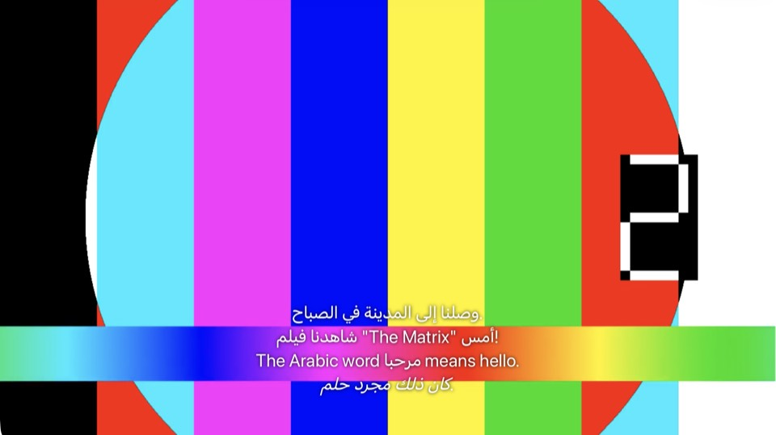</a> | <a href="rtl-fix-verification/safari/fix/12.2/embedded-arabic-srt-cue1.jpg"></a> | <a href="rtl-fix-verification/safari/control/12.2/embedded-arabic-srt-cue2.jpg"></a> | <a href="rtl-fix-verification/safari/fix/12.2/embedded-arabic-srt-cue2.jpg">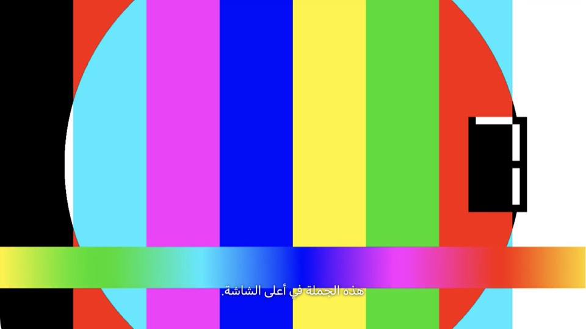</a> |
| Safari, Uploaded, Arabic SRT | Custom element | **Pass**. Bug in the control, fixed in the fix run. | <a href="rtl-fix-verification/safari/control/12.2/uploaded-arabic-srt-cue1.jpg"></a> | <a href="rtl-fix-verification/safari/fix/12.2/uploaded-arabic-srt-cue1.jpg"></a> | <a href="rtl-fix-verification/safari/control/12.2/uploaded-arabic-srt-cue2.jpg"></a> | <a href="rtl-fix-verification/safari/fix/12.2/uploaded-arabic-srt-cue2.jpg"></a> |
| Safari, External, English SRT | Custom element | **Pass**. Pixel for pixel the same as the control. | <a href="rtl-fix-verification/safari/control/12.2/external-english-srt-cue1.jpg">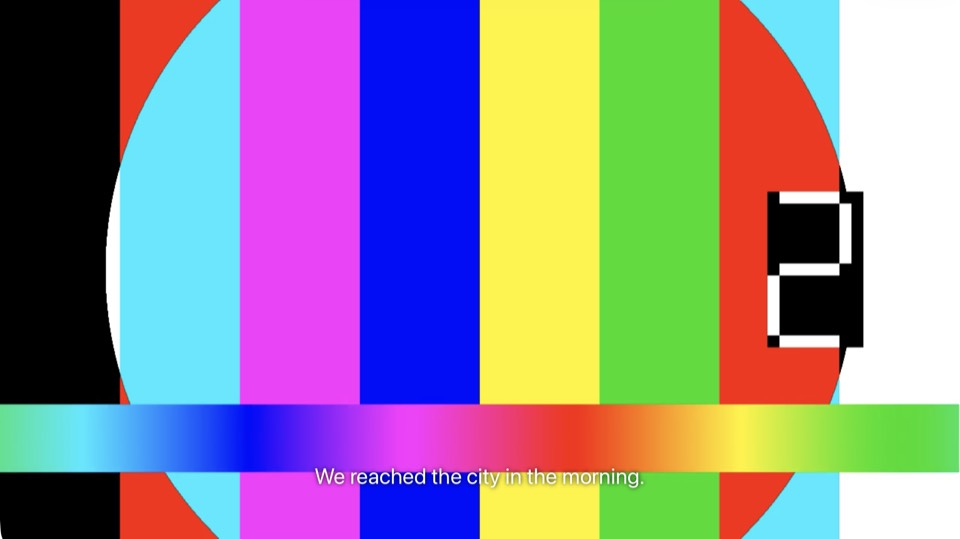</a> | <a href="rtl-fix-verification/safari/fix/12.2/external-english-srt-cue1.jpg"></a> | <a href="rtl-fix-verification/safari/control/12.2/external-english-srt-cue2.jpg"></a> | <a href="rtl-fix-verification/safari/fix/12.2/external-english-srt-cue2.jpg"></a> |
| Safari, Embedded, Arabic ASS | SubtitlesOctopus canvas | **Pass**. Pixel for pixel the same as the control. | <a href="rtl-fix-verification/safari/control/12.2/embedded-arabic-ass-cue1.jpg"></a> | <a href="rtl-fix-verification/safari/fix/12.2/embedded-arabic-ass-cue1.jpg">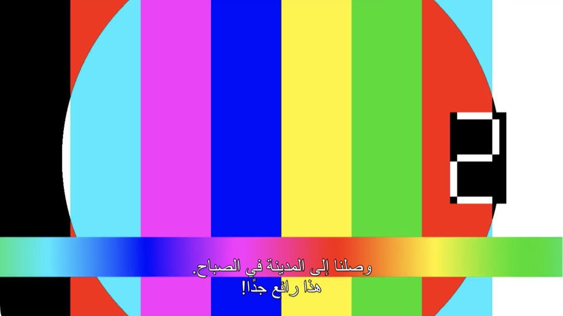</a> | <a href="rtl-fix-verification/safari/control/12.2/embedded-arabic-ass-cue2.jpg"></a> | <a href="rtl-fix-verification/safari/fix/12.2/embedded-arabic-ass-cue2.jpg"></a> |

### Built-in browser

| Check | Renderer | Result | Control, cue 1 | Fix, cue 1 | Control, cue 2 | Fix, cue 2 |
| --- | --- | --- | --- | --- | --- | --- |
| Built-in browser, External, Arabic SRT | Native cue | **Pass**. Bug in the control, fixed in the fix run. The fix run's `Stream.js` held the marks. | <a href="rtl-fix-verification/browser/control/12.2/external-arabic-srt-cue1.jpg"></a> | <a href="rtl-fix-verification/browser/fix/12.2/external-arabic-srt-cue1.jpg">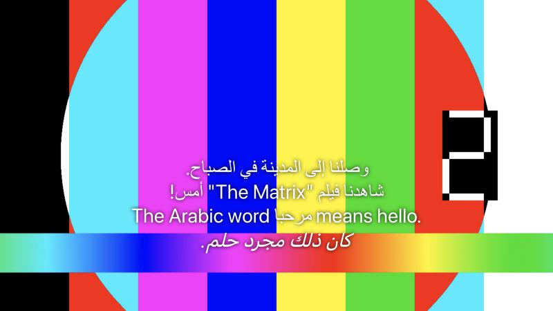</a> | <a href="rtl-fix-verification/browser/control/12.2/external-arabic-srt-cue2.jpg"></a> | <a href="rtl-fix-verification/browser/fix/12.2/external-arabic-srt-cue2.jpg"></a> |
| Built-in browser, Embedded, Arabic SRT | Native cue | **Pass**. Bug in the control, fixed in the fix run. The fix run's `Stream.js` held the marks. | <a href="rtl-fix-verification/browser/control/12.2/embedded-arabic-srt-cue1.jpg"></a> | <a href="rtl-fix-verification/browser/fix/12.2/embedded-arabic-srt-cue1.jpg"></a> | <a href="rtl-fix-verification/browser/control/12.2/embedded-arabic-srt-cue2.jpg"></a> | <a href="rtl-fix-verification/browser/fix/12.2/embedded-arabic-srt-cue2.jpg"></a> |
| Built-in browser, Uploaded, Arabic SRT | Native cue | **Pass**. Bug in the control, fixed in the fix run. The fix run's `Stream.js` held the marks. | <a href="rtl-fix-verification/browser/control/12.2/uploaded-arabic-srt-cue1.jpg"></a> | <a href="rtl-fix-verification/browser/fix/12.2/uploaded-arabic-srt-cue1.jpg"></a> | <a href="rtl-fix-verification/browser/control/12.2/uploaded-arabic-srt-cue2.jpg"></a> | <a href="rtl-fix-verification/browser/fix/12.2/uploaded-arabic-srt-cue2.jpg">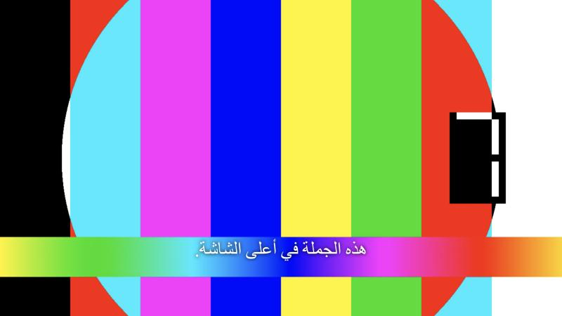</a> |
| Built-in browser, External, English SRT | Native cue | **Pass**. Byte for byte the same screenshot as the control. | <a href="rtl-fix-verification/browser/control/12.2/external-english-srt-cue1.jpg"></a> | <a href="rtl-fix-verification/browser/fix/12.2/external-english-srt-cue1.jpg"></a> | <a href="rtl-fix-verification/browser/control/12.2/external-english-srt-cue2.jpg"></a> | <a href="rtl-fix-verification/browser/fix/12.2/external-english-srt-cue2.jpg"></a> |
| Built-in browser, Embedded, Arabic ASS | SubtitlesOctopus canvas | **Pass**. Byte for byte the same screenshot as the control. | <a href="rtl-fix-verification/browser/control/12.2/embedded-arabic-ass-cue1.jpg"></a> | <a href="rtl-fix-verification/browser/fix/12.2/embedded-arabic-ass-cue1.jpg"></a> | <a href="rtl-fix-verification/browser/control/12.2/embedded-arabic-ass-cue2.jpg"></a> | <a href="rtl-fix-verification/browser/fix/12.2/embedded-arabic-ass-cue2.jpg"></a> |

### Burn-in

| Check | Result | Control filter | Fix filter | Control, cue 1 | Fix, cue 1 | Control, cue 2 | Fix, cue 2 |
| --- | --- | --- | --- | --- | --- | --- | --- |
| Burn-in, External, Arabic SRT | **Pass**. Bug in the control, fixed in the fix run. The fix run's copy is UTF-8 with 4 RLE and 4 PDF. | `…/Lazyfin RTL External (2026).ar.srt':charenc=utf-8` | `<cache>/lazyfin/rtl-fix/4ca7dd9a….srt`, no `:charenc=` | <a href="rtl-fix-verification/burn-in/control/12.2/external-arabic-srt-cue1.jpg">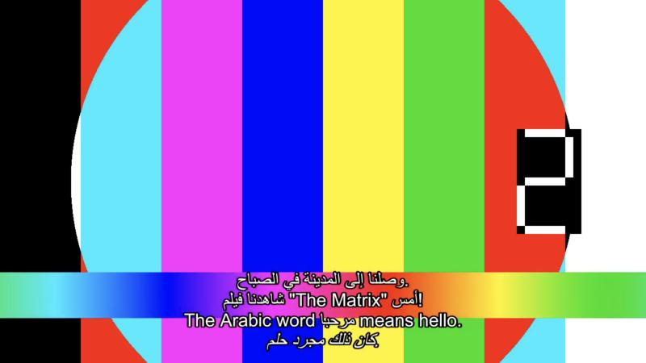</a> | <a href="rtl-fix-verification/burn-in/fix/12.2/external-arabic-srt-cue1.jpg"></a> | <a href="rtl-fix-verification/burn-in/control/12.2/external-arabic-srt-cue2.jpg"></a> | <a href="rtl-fix-verification/burn-in/fix/12.2/external-arabic-srt-cue2.jpg"></a> |
| Burn-in, Embedded, Arabic SRT | **Pass**. Bug in the control, fixed in the fix run. The fix run's copy is UTF-8 with 4 RLE and 4 PDF. | `<data>/subtitles/6f/…/2.srt`, the server's extracted track | `<cache>/lazyfin/rtl-fix/3468d87f….srt`, no `:charenc=` | <a href="rtl-fix-verification/burn-in/control/12.2/embedded-arabic-srt-cue1.jpg"></a> | <a href="rtl-fix-verification/burn-in/fix/12.2/embedded-arabic-srt-cue1.jpg">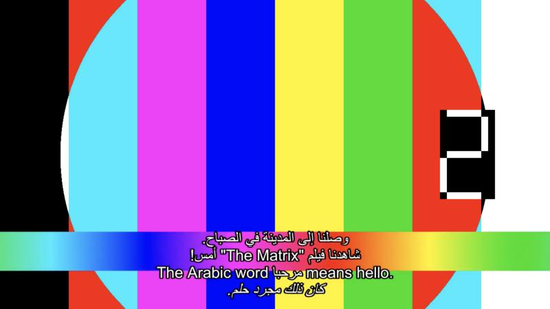</a> | <a href="rtl-fix-verification/burn-in/control/12.2/embedded-arabic-srt-cue2.jpg"></a> | <a href="rtl-fix-verification/burn-in/fix/12.2/embedded-arabic-srt-cue2.jpg"></a> |
| Burn-in, Uploaded, Arabic SRT | **Pass**. Bug in the control, fixed in the fix run. The fix run's copy is UTF-8 with 4 RLE and 4 PDF. | `…/Lazyfin RTL Uploaded (2026).ara.srt':charenc=utf-8` | `<cache>/lazyfin/rtl-fix/facbc495….srt`, no `:charenc=` | <a href="rtl-fix-verification/burn-in/control/12.2/uploaded-arabic-srt-cue1.jpg"></a> | <a href="rtl-fix-verification/burn-in/fix/12.2/uploaded-arabic-srt-cue1.jpg"></a> | <a href="rtl-fix-verification/burn-in/control/12.2/uploaded-arabic-srt-cue2.jpg"></a> | <a href="rtl-fix-verification/burn-in/fix/12.2/uploaded-arabic-srt-cue2.jpg"></a> |
| Burn-in, Windows-1256, Arabic SRT | **Pass**. Bug in the control, fixed in the fix run. The fix run's copy is UTF-8 with 4 RLE and 4 PDF. | `…/Lazyfin RTL Windows-1256 (2026).ar.srt':charenc=windows-1256` | `<cache>/lazyfin/rtl-fix/6b277ee6….srt`, no `:charenc=` | <a href="rtl-fix-verification/burn-in/control/12.2/windows-1256-arabic-srt-cue1.jpg"></a> | <a href="rtl-fix-verification/burn-in/fix/12.2/windows-1256-arabic-srt-cue1.jpg"></a> | <a href="rtl-fix-verification/burn-in/control/12.2/windows-1256-arabic-srt-cue2.jpg"></a> | <a href="rtl-fix-verification/burn-in/fix/12.2/windows-1256-arabic-srt-cue2.jpg"></a> |
| Burn-in, External, English SRT | **Pass**. Byte for byte the same screenshot and the same filter as the control. | `…/Lazyfin RTL External (2026).en.srt':charenc=ascii` | The same as the control | <a href="rtl-fix-verification/burn-in/control/12.2/external-english-srt-cue1.jpg"></a> | <a href="rtl-fix-verification/burn-in/fix/12.2/external-english-srt-cue1.jpg"></a> | <a href="rtl-fix-verification/burn-in/control/12.2/external-english-srt-cue2.jpg"></a> | <a href="rtl-fix-verification/burn-in/fix/12.2/external-english-srt-cue2.jpg"></a> |
| Burn-in, Embedded, Arabic ASS | **Pass**. Byte for byte the same screenshot and the same filter as the control. | `<data>/subtitles/6f/…/3.ass`, the server's extracted track | The same as the control | <a href="rtl-fix-verification/burn-in/control/12.2/embedded-arabic-ass-cue1.jpg"></a> | <a href="rtl-fix-verification/burn-in/fix/12.2/embedded-arabic-ass-cue1.jpg">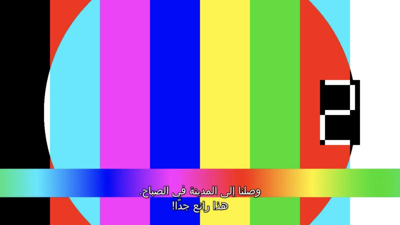</a> | <a href="rtl-fix-verification/burn-in/control/12.2/embedded-arabic-ass-cue2.jpg"></a> | <a href="rtl-fix-verification/burn-in/fix/12.2/embedded-arabic-ass-cue2.jpg"></a> |

The `subtitles=` filter of each burn-in, from the newest transcode log after each play. `<repo>` is the main checkout.

```text
control Embedded     Arabic ASS  subtitles=f='<repo>/.temp/servers/12.2/data/data/subtitles/6f/6f5ac2d0-1781-a169-41d3-669b8dc36c77/3.ass':fontsdir='<repo>/.temp/servers/12.2/data/data/attachments/6f/6f5ac2d0-1781-a169-41d3-669b8dc36c77'
control Embedded     Arabic SRT  subtitles=f='<repo>/.temp/servers/12.2/data/data/subtitles/6f/6f5ac2d0-1781-a169-41d3-669b8dc36c77/2.srt':fontsdir='<repo>/.temp/servers/12.2/data/data/attachments/6f/6f5ac2d0-1781-a169-41d3-669b8dc36c77'
control External     Arabic SRT  subtitles=f='<repo>/.temp/rtl-check/library/Lazyfin RTL External (2026)/Lazyfin RTL External (2026).ar.srt':charenc=utf-8:fontsdir='<repo>/.temp/servers/12.2/data/data/attachments/40/40aff9e6-04c4-fe4c-0658-86dd18890b5a'
control External     English SRT subtitles=f='<repo>/.temp/rtl-check/library/Lazyfin RTL External (2026)/Lazyfin RTL External (2026).en.srt':charenc=ascii:fontsdir='<repo>/.temp/servers/12.2/data/data/attachments/40/40aff9e6-04c4-fe4c-0658-86dd18890b5a'
control Uploaded     Arabic SRT  subtitles=f='<repo>/.temp/rtl-check/library/Lazyfin RTL Uploaded (2026)/Lazyfin RTL Uploaded (2026).ara.srt':charenc=utf-8:fontsdir='<repo>/.temp/servers/12.2/data/data/attachments/72/72822f2b-3b4b-37e7-f7fb-b4204be91069'
control Windows-1256 Arabic SRT  subtitles=f='<repo>/.temp/rtl-check/library/Lazyfin RTL Windows-1256 (2026)/Lazyfin RTL Windows-1256 (2026).ar.srt':charenc=windows-1256:fontsdir='<repo>/.temp/servers/12.2/data/data/attachments/b0/b05cbdd8-c44f-c99a-be3b-2c176b024d13'
fix     Embedded     Arabic ASS  subtitles=f='<repo>/.temp/servers/12.2/data/data/subtitles/6f/6f5ac2d0-1781-a169-41d3-669b8dc36c77/3.ass':fontsdir='<repo>/.temp/servers/12.2/data/data/attachments/6f/6f5ac2d0-1781-a169-41d3-669b8dc36c77'
fix     Embedded     Arabic SRT  subtitles=f='<repo>/.temp/servers/12.2/cache/lazyfin/rtl-fix/3468d87f828de795225d5b8621dbe957c460d8b48331ba1ea33980bbd41faa1c.srt':fontsdir='<repo>/.temp/servers/12.2/data/data/attachments/6f/6f5ac2d0-1781-a169-41d3-669b8dc36c77'
fix     External     Arabic SRT  subtitles=f='<repo>/.temp/servers/12.2/cache/lazyfin/rtl-fix/4ca7dd9a7b462e1ca964ba5d14d7cf851440bdf6b371eda7276c8c3caea281c1.srt':fontsdir='<repo>/.temp/servers/12.2/data/data/attachments/40/40aff9e6-04c4-fe4c-0658-86dd18890b5a'
fix     External     English SRT subtitles=f='<repo>/.temp/rtl-check/library/Lazyfin RTL External (2026)/Lazyfin RTL External (2026).en.srt':charenc=ascii:fontsdir='<repo>/.temp/servers/12.2/data/data/attachments/40/40aff9e6-04c4-fe4c-0658-86dd18890b5a'
fix     Uploaded     Arabic SRT  subtitles=f='<repo>/.temp/servers/12.2/cache/lazyfin/rtl-fix/facbc495dc885e8dd6c78f994b8a5c5e6d608a121a8079a6ac50311be1c98275.srt':fontsdir='<repo>/.temp/servers/12.2/data/data/attachments/72/72822f2b-3b4b-37e7-f7fb-b4204be91069'
fix     Windows-1256 Arabic SRT  subtitles=f='<repo>/.temp/servers/12.2/cache/lazyfin/rtl-fix/6b277ee6041c7f31bd4d70c11524d93c0c4287c049a593d6df0e7d1d0d1c286b.srt':fontsdir='<repo>/.temp/servers/12.2/data/data/attachments/b0/b05cbdd8-c44f-c99a-be3b-2c176b024d13'
```

## 13.0

### Subtitle bytes

| Check | JSON | WebVTT | SRT | ASS | HLS segment |
| --- | --- | --- | --- | --- | --- |
| Bytes, External, Arabic SRT | Pass | Pass | Pass | | Pass |
| Bytes, External, English SRT | Pass | Pass | Pass | | Pass |
| Bytes, Embedded, Arabic SRT | Pass | Pass | Pass | | Pass |
| Bytes, Embedded, Arabic ASS | Pass | Pass | Pass | Pass | Pass |
| Bytes, Uploaded, Arabic SRT | Pass | Pass | Pass | | Pass |
| Bytes, Windows-1256, Arabic SRT | Info | Info | Info | | Info |

Script output:

```text
PASS 13.0  Embedded      2-ara-subrip   hls  4 of 4 RTL lines wrapped, 1 other lines unmarked
PASS 13.0  Embedded      2-ara-subrip   js   4 of 4 RTL lines wrapped, 1 other lines unmarked
PASS 13.0  Embedded      2-ara-subrip   srt  4 of 4 RTL lines wrapped, 1 other lines unmarked
PASS 13.0  Embedded      2-ara-subrip   vtt  4 of 4 RTL lines wrapped, 1 other lines unmarked
PASS 13.0  Embedded      3-ara-ass      ass  byte for byte the same as control
PASS 13.0  Embedded      3-ara-ass      hls  byte for byte the same as control
PASS 13.0  Embedded      3-ara-ass      js   byte for byte the same as control
PASS 13.0  Embedded      3-ara-ass      srt  byte for byte the same as control
PASS 13.0  Embedded      3-ara-ass      vtt  byte for byte the same as control
PASS 13.0  External      0-ara-subrip   hls  4 of 4 RTL lines wrapped, 1 other lines unmarked
PASS 13.0  External      0-ara-subrip   js   4 of 4 RTL lines wrapped, 1 other lines unmarked
PASS 13.0  External      0-ara-subrip   srt  4 of 4 RTL lines wrapped, 1 other lines unmarked
PASS 13.0  External      0-ara-subrip   vtt  4 of 4 RTL lines wrapped, 1 other lines unmarked
PASS 13.0  External      1-eng-subrip   hls  byte for byte the same as control
PASS 13.0  External      1-eng-subrip   js   byte for byte the same as control
PASS 13.0  External      1-eng-subrip   srt  byte for byte the same as control
PASS 13.0  External      1-eng-subrip   vtt  byte for byte the same as control
PASS 13.0  Uploaded      0-ara-subrip   hls  4 of 4 RTL lines wrapped, 1 other lines unmarked
PASS 13.0  Uploaded      0-ara-subrip   js   4 of 4 RTL lines wrapped, 1 other lines unmarked
PASS 13.0  Uploaded      0-ara-subrip   srt  4 of 4 RTL lines wrapped, 1 other lines unmarked
PASS 13.0  Uploaded      0-ara-subrip   vtt  4 of 4 RTL lines wrapped, 1 other lines unmarked
INFO 13.0  Windows-1256  0-ara-subrip   hls  4 of 4 RTL lines wrapped, 1 other lines unmarked
INFO 13.0  Windows-1256  0-ara-subrip   js   4 of 4 RTL lines wrapped, 1 other lines unmarked
INFO 13.0  Windows-1256  0-ara-subrip   srt  4 of 4 RTL lines wrapped, 1 other lines unmarked
INFO 13.0  Windows-1256  0-ara-subrip   vtt  4 of 4 RTL lines wrapped, 1 other lines unmarked
```

### Safari web player

| Check | Renderer | Result | Control, cue 1 | Fix, cue 1 | Control, cue 2 | Fix, cue 2 |
| --- | --- | --- | --- | --- | --- | --- |
| Safari, External, Arabic SRT | Custom element | **Pass**. Bug in the control, fixed in the fix run. | <a href="rtl-fix-verification/safari/control/13.0/external-arabic-srt-cue1.jpg"></a> | <a href="rtl-fix-verification/safari/fix/13.0/external-arabic-srt-cue1.jpg"></a> | <a href="rtl-fix-verification/safari/control/13.0/external-arabic-srt-cue2.jpg"></a> | <a href="rtl-fix-verification/safari/fix/13.0/external-arabic-srt-cue2.jpg"></a> |
| Safari, Embedded, Arabic SRT | Custom element | **Pass**. Bug in the control, fixed in the fix run. | <a href="rtl-fix-verification/safari/control/13.0/embedded-arabic-srt-cue1.jpg"></a> | <a href="rtl-fix-verification/safari/fix/13.0/embedded-arabic-srt-cue1.jpg"></a> | <a href="rtl-fix-verification/safari/control/13.0/embedded-arabic-srt-cue2.jpg"></a> | <a href="rtl-fix-verification/safari/fix/13.0/embedded-arabic-srt-cue2.jpg"></a> |
| Safari, Uploaded, Arabic SRT | Custom element | **Pass**. Bug in the control, fixed in the fix run. | <a href="rtl-fix-verification/safari/control/13.0/uploaded-arabic-srt-cue1.jpg"></a> | <a href="rtl-fix-verification/safari/fix/13.0/uploaded-arabic-srt-cue1.jpg"></a> | <a href="rtl-fix-verification/safari/control/13.0/uploaded-arabic-srt-cue2.jpg"></a> | <a href="rtl-fix-verification/safari/fix/13.0/uploaded-arabic-srt-cue2.jpg"></a> |
| Safari, External, English SRT | Custom element | **Pass**. Pixel for pixel the same as the control. | <a href="rtl-fix-verification/safari/control/13.0/external-english-srt-cue1.jpg"></a> | <a href="rtl-fix-verification/safari/fix/13.0/external-english-srt-cue1.jpg"></a> | <a href="rtl-fix-verification/safari/control/13.0/external-english-srt-cue2.jpg"></a> | <a href="rtl-fix-verification/safari/fix/13.0/external-english-srt-cue2.jpg"></a> |
| Safari, Embedded, Arabic ASS | SubtitlesOctopus canvas | **Pass**. Pixel for pixel the same as the control. | <a href="rtl-fix-verification/safari/control/13.0/embedded-arabic-ass-cue1.jpg"></a> | <a href="rtl-fix-verification/safari/fix/13.0/embedded-arabic-ass-cue1.jpg"></a> | <a href="rtl-fix-verification/safari/control/13.0/embedded-arabic-ass-cue2.jpg"></a> | <a href="rtl-fix-verification/safari/fix/13.0/embedded-arabic-ass-cue2.jpg"></a> |

### Built-in browser

| Check | Renderer | Result | Control, cue 1 | Fix, cue 1 | Control, cue 2 | Fix, cue 2 |
| --- | --- | --- | --- | --- | --- | --- |
| Built-in browser, External, Arabic SRT | Native cue | **Pass**. Bug in the control, fixed in the fix run. The fix run's `Stream.js` held the marks. | <a href="rtl-fix-verification/browser/control/13.0/external-arabic-srt-cue1.jpg"></a> | <a href="rtl-fix-verification/browser/fix/13.0/external-arabic-srt-cue1.jpg"></a> | <a href="rtl-fix-verification/browser/control/13.0/external-arabic-srt-cue2.jpg"></a> | <a href="rtl-fix-verification/browser/fix/13.0/external-arabic-srt-cue2.jpg"></a> |
| Built-in browser, Embedded, Arabic SRT | Native cue | **Pass**. Bug in the control, fixed in the fix run. The fix run's `Stream.js` held the marks. | <a href="rtl-fix-verification/browser/control/13.0/embedded-arabic-srt-cue1.jpg">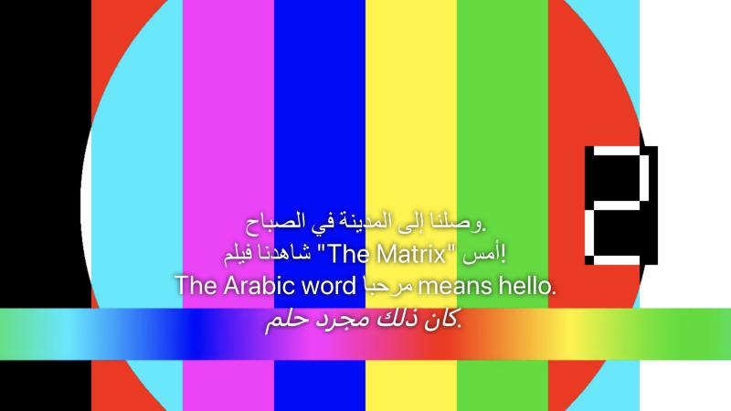</a> | <a href="rtl-fix-verification/browser/fix/13.0/embedded-arabic-srt-cue1.jpg"></a> | <a href="rtl-fix-verification/browser/control/13.0/embedded-arabic-srt-cue2.jpg">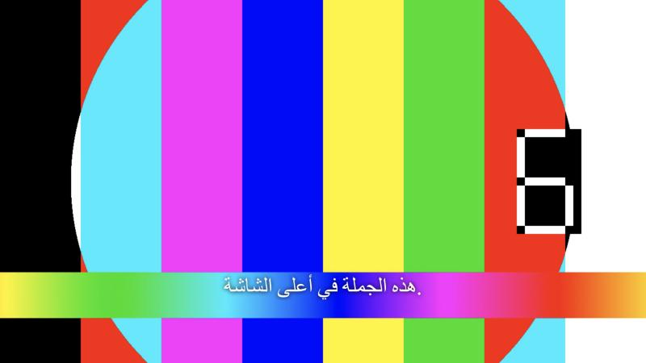</a> | <a href="rtl-fix-verification/browser/fix/13.0/embedded-arabic-srt-cue2.jpg"></a> |
| Built-in browser, Uploaded, Arabic SRT | Native cue | **Pass**. Bug in the control, fixed in the fix run. The fix run's `Stream.js` held the marks. | <a href="rtl-fix-verification/browser/control/13.0/uploaded-arabic-srt-cue1.jpg">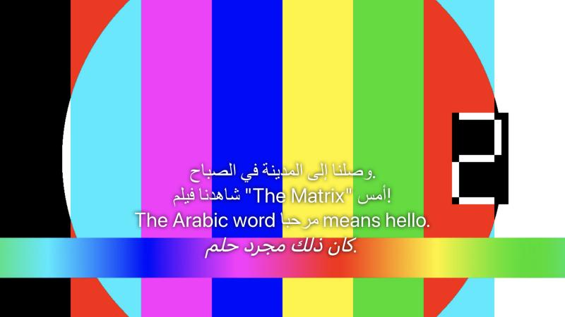</a> | <a href="rtl-fix-verification/browser/fix/13.0/uploaded-arabic-srt-cue1.jpg"></a> | <a href="rtl-fix-verification/browser/control/13.0/uploaded-arabic-srt-cue2.jpg"></a> | <a href="rtl-fix-verification/browser/fix/13.0/uploaded-arabic-srt-cue2.jpg"></a> |
| Built-in browser, External, English SRT | Native cue | **Pass**. Byte for byte the same screenshot as the control. | <a href="rtl-fix-verification/browser/control/13.0/external-english-srt-cue1.jpg"></a> | <a href="rtl-fix-verification/browser/fix/13.0/external-english-srt-cue1.jpg">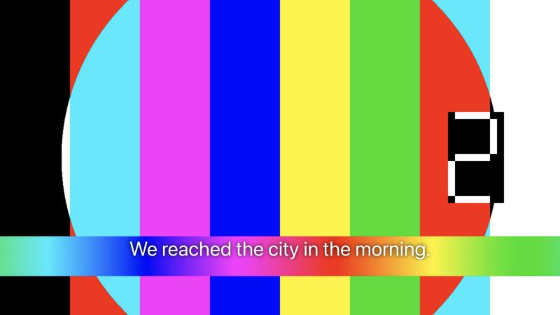</a> | <a href="rtl-fix-verification/browser/control/13.0/external-english-srt-cue2.jpg"></a> | <a href="rtl-fix-verification/browser/fix/13.0/external-english-srt-cue2.jpg"></a> |
| Built-in browser, Embedded, Arabic ASS | SubtitlesOctopus canvas | **Pass**. Byte for byte the same screenshot as the control. | <a href="rtl-fix-verification/browser/control/13.0/embedded-arabic-ass-cue1.jpg"></a> | <a href="rtl-fix-verification/browser/fix/13.0/embedded-arabic-ass-cue1.jpg"></a> | <a href="rtl-fix-verification/browser/control/13.0/embedded-arabic-ass-cue2.jpg"></a> | <a href="rtl-fix-verification/browser/fix/13.0/embedded-arabic-ass-cue2.jpg">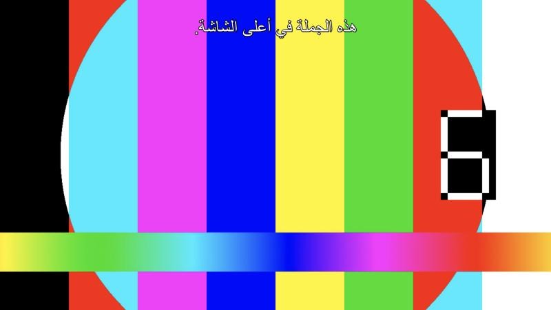</a> |

### Burn-in

| Check | Result | Control filter | Fix filter | Control, cue 1 | Fix, cue 1 | Control, cue 2 | Fix, cue 2 |
| --- | --- | --- | --- | --- | --- | --- | --- |
| Burn-in, External, Arabic SRT | **Pass**. Bug in the control, fixed in the fix run. The fix run's copy is UTF-8 with 4 RLE and 4 PDF. | `…/Lazyfin RTL External (2026).ar.srt':charenc=utf-8` | `<cache>/lazyfin/rtl-fix/4ca7dd9a….srt`, no `:charenc=` | <a href="rtl-fix-verification/burn-in/control/13.0/external-arabic-srt-cue1.jpg"></a> | <a href="rtl-fix-verification/burn-in/fix/13.0/external-arabic-srt-cue1.jpg"></a> | <a href="rtl-fix-verification/burn-in/control/13.0/external-arabic-srt-cue2.jpg"></a> | <a href="rtl-fix-verification/burn-in/fix/13.0/external-arabic-srt-cue2.jpg"></a> |
| Burn-in, Embedded, Arabic SRT | **Pass**. Bug in the control, fixed in the fix run. The fix run's copy is UTF-8 with 4 RLE and 4 PDF. | `<data>/subtitles/6f/…/2.srt`, the server's extracted track | `<cache>/lazyfin/rtl-fix/8ee18d8b….srt`, no `:charenc=` | <a href="rtl-fix-verification/burn-in/control/13.0/embedded-arabic-srt-cue1.jpg"></a> | <a href="rtl-fix-verification/burn-in/fix/13.0/embedded-arabic-srt-cue1.jpg"></a> | <a href="rtl-fix-verification/burn-in/control/13.0/embedded-arabic-srt-cue2.jpg"></a> | <a href="rtl-fix-verification/burn-in/fix/13.0/embedded-arabic-srt-cue2.jpg">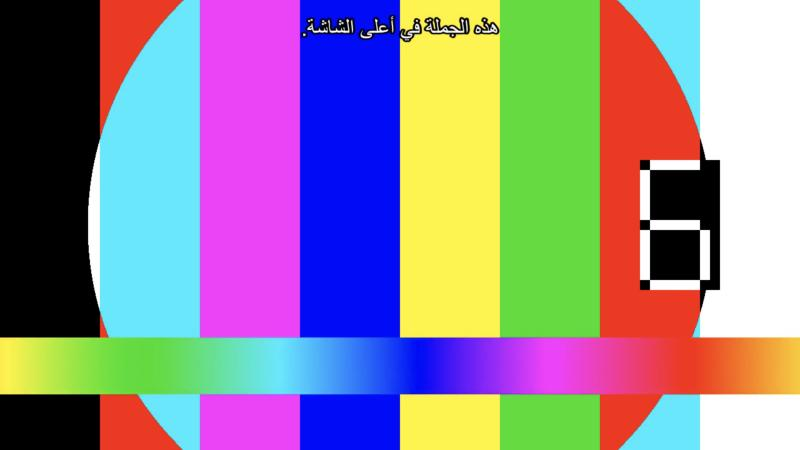</a> |
| Burn-in, Uploaded, Arabic SRT | **Pass**. Bug in the control, fixed in the fix run. The fix run's copy is UTF-8 with 4 RLE and 4 PDF. | `…/Lazyfin RTL Uploaded (2026).ara.srt':charenc=utf-8` | `<cache>/lazyfin/rtl-fix/facbc495….srt`, no `:charenc=` | <a href="rtl-fix-verification/burn-in/control/13.0/uploaded-arabic-srt-cue1.jpg"></a> | <a href="rtl-fix-verification/burn-in/fix/13.0/uploaded-arabic-srt-cue1.jpg"></a> | <a href="rtl-fix-verification/burn-in/control/13.0/uploaded-arabic-srt-cue2.jpg">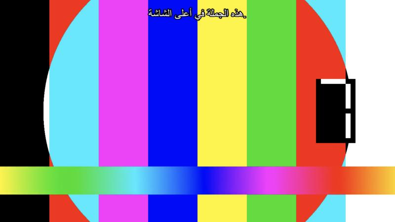</a> | <a href="rtl-fix-verification/burn-in/fix/13.0/uploaded-arabic-srt-cue2.jpg"></a> |
| Burn-in, Windows-1256, Arabic SRT | **Pass**. Bug in the control, fixed in the fix run. The fix run's copy is UTF-8 with 4 RLE and 4 PDF. | `…/Lazyfin RTL Windows-1256 (2026).ar.srt':charenc=windows-1256` | `<cache>/lazyfin/rtl-fix/6b277ee6….srt`, no `:charenc=` | <a href="rtl-fix-verification/burn-in/control/13.0/windows-1256-arabic-srt-cue1.jpg"></a> | <a href="rtl-fix-verification/burn-in/fix/13.0/windows-1256-arabic-srt-cue1.jpg"></a> | <a href="rtl-fix-verification/burn-in/control/13.0/windows-1256-arabic-srt-cue2.jpg"></a> | <a href="rtl-fix-verification/burn-in/fix/13.0/windows-1256-arabic-srt-cue2.jpg"></a> |
| Burn-in, External, English SRT | **Pass**. Byte for byte the same screenshot and the same filter as the control. | `…/Lazyfin RTL External (2026).en.srt':charenc=ascii` | The same as the control | <a href="rtl-fix-verification/burn-in/control/13.0/external-english-srt-cue1.jpg"></a> | <a href="rtl-fix-verification/burn-in/fix/13.0/external-english-srt-cue1.jpg">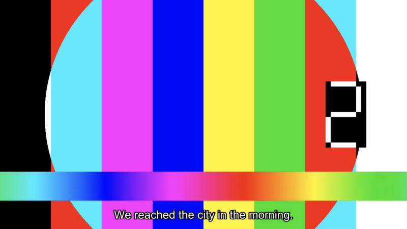</a> | <a href="rtl-fix-verification/burn-in/control/13.0/external-english-srt-cue2.jpg">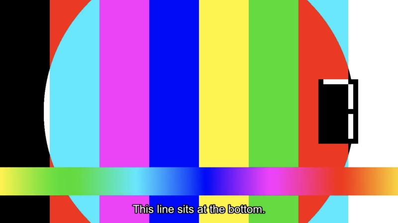</a> | <a href="rtl-fix-verification/burn-in/fix/13.0/external-english-srt-cue2.jpg"></a> |
| Burn-in, Embedded, Arabic ASS | **Pass**. Byte for byte the same screenshot and the same filter as the control. | `<data>/subtitles/6f/…/3.ass`, the server's extracted track | The same as the control | <a href="rtl-fix-verification/burn-in/control/13.0/embedded-arabic-ass-cue1.jpg"></a> | <a href="rtl-fix-verification/burn-in/fix/13.0/embedded-arabic-ass-cue1.jpg"></a> | <a href="rtl-fix-verification/burn-in/control/13.0/embedded-arabic-ass-cue2.jpg"></a> | <a href="rtl-fix-verification/burn-in/fix/13.0/embedded-arabic-ass-cue2.jpg"></a> |

The `subtitles=` filter of each burn-in, from the newest transcode log after each play. `<repo>` is the main checkout.

```text
control Embedded     Arabic ASS  subtitles=f='<repo>/.temp/servers/13.0-2026101212/data/data/subtitles/6f/6f5ac2d0-1781-a169-41d3-669b8dc36c77/3.ass':fontsdir='<repo>/.temp/servers/13.0-2026101212/data/data/attachments/6f/6f5ac2d0-1781-a169-41d3-669b8dc36c77'
control Embedded     Arabic SRT  subtitles=f='<repo>/.temp/servers/13.0-2026101212/data/data/subtitles/6f/6f5ac2d0-1781-a169-41d3-669b8dc36c77/2.srt':fontsdir='<repo>/.temp/servers/13.0-2026101212/data/data/attachments/6f/6f5ac2d0-1781-a169-41d3-669b8dc36c77'
control External     Arabic SRT  subtitles=f='<repo>/.temp/rtl-check/library/Lazyfin RTL External (2026)/Lazyfin RTL External (2026).ar.srt':charenc=utf-8:fontsdir='<repo>/.temp/servers/13.0-2026101212/data/data/attachments/40/40aff9e6-04c4-fe4c-0658-86dd18890b5a'
control External     English SRT subtitles=f='<repo>/.temp/rtl-check/library/Lazyfin RTL External (2026)/Lazyfin RTL External (2026).en.srt':charenc=ascii:fontsdir='<repo>/.temp/servers/13.0-2026101212/data/data/attachments/40/40aff9e6-04c4-fe4c-0658-86dd18890b5a'
control Uploaded     Arabic SRT  subtitles=f='<repo>/.temp/rtl-check/library/Lazyfin RTL Uploaded (2026)/Lazyfin RTL Uploaded (2026).ara.srt':charenc=utf-8:fontsdir='<repo>/.temp/servers/13.0-2026101212/data/data/attachments/72/72822f2b-3b4b-37e7-f7fb-b4204be91069'
control Windows-1256 Arabic SRT  subtitles=f='<repo>/.temp/rtl-check/library/Lazyfin RTL Windows-1256 (2026)/Lazyfin RTL Windows-1256 (2026).ar.srt':charenc=windows-1256:fontsdir='<repo>/.temp/servers/13.0-2026101212/data/data/attachments/b0/b05cbdd8-c44f-c99a-be3b-2c176b024d13'
fix     Embedded     Arabic ASS  subtitles=f='<repo>/.temp/servers/13.0-2026101212/data/data/subtitles/6f/6f5ac2d0-1781-a169-41d3-669b8dc36c77/3.ass':fontsdir='<repo>/.temp/servers/13.0-2026101212/data/data/attachments/6f/6f5ac2d0-1781-a169-41d3-669b8dc36c77'
fix     Embedded     Arabic SRT  subtitles=f='<repo>/.temp/servers/13.0-2026101212/cache/lazyfin/rtl-fix/8ee18d8bde8cbd90a4fbcbe2654795bf34c53c5b6fefc53ebf60cc52855a236d.srt':fontsdir='<repo>/.temp/servers/13.0-2026101212/data/data/attachments/6f/6f5ac2d0-1781-a169-41d3-669b8dc36c77'
fix     External     Arabic SRT  subtitles=f='<repo>/.temp/servers/13.0-2026101212/cache/lazyfin/rtl-fix/4ca7dd9a7b462e1ca964ba5d14d7cf851440bdf6b371eda7276c8c3caea281c1.srt':fontsdir='<repo>/.temp/servers/13.0-2026101212/data/data/attachments/40/40aff9e6-04c4-fe4c-0658-86dd18890b5a'
fix     External     English SRT subtitles=f='<repo>/.temp/rtl-check/library/Lazyfin RTL External (2026)/Lazyfin RTL External (2026).en.srt':charenc=ascii:fontsdir='<repo>/.temp/servers/13.0-2026101212/data/data/attachments/40/40aff9e6-04c4-fe4c-0658-86dd18890b5a'
fix     Uploaded     Arabic SRT  subtitles=f='<repo>/.temp/servers/13.0-2026101212/cache/lazyfin/rtl-fix/facbc495dc885e8dd6c78f994b8a5c5e6d608a121a8079a6ac50311be1c98275.srt':fontsdir='<repo>/.temp/servers/13.0-2026101212/data/data/attachments/72/72822f2b-3b4b-37e7-f7fb-b4204be91069'
fix     Windows-1256 Arabic SRT  subtitles=f='<repo>/.temp/servers/13.0-2026101212/cache/lazyfin/rtl-fix/6b277ee6041c7f31bd4d70c11524d93c0c4287c049a593d6df0e7d1d0d1c286b.srt':fontsdir='<repo>/.temp/servers/13.0-2026101212/data/data/attachments/b0/b05cbdd8-c44f-c99a-be3b-2c176b024d13'
```

## The library files

The script hashed every subtitle file in the library, the MKV included, before the control run, right after the upload, and after the fix run. Every file is byte for byte the same after the fix run, and Lazyfin wrote nothing into the library.

```text
PASS library Lazyfin RTL Embedded (2026)/Lazyfin RTL Embedded (2026).mkv: same as before the control run
PASS library Lazyfin RTL External (2026)/Lazyfin RTL External (2026).ar.srt: same as before the control run
PASS library Lazyfin RTL External (2026)/Lazyfin RTL External (2026).en.srt: same as before the control run
PASS library Lazyfin RTL Uploaded (2026)/Lazyfin RTL Uploaded (2026).ara.srt: same as right after the upload
PASS library Lazyfin RTL Windows-1256 (2026)/Lazyfin RTL Windows-1256 (2026).ar.srt: same as before the control run
```

## Burn-in font check

One burned-in control frame per server, with Lazyfin uninstalled: the External movie's Arabic SRT at 2 s, through an HLS transcode with `SubtitleMethod=Encode`, cropped to the subtitle. Arabic draws as real letters on both servers, so no fallback font is needed. The control shows the bug: the period and the `!` sit at the right end, where an Arabic reader starts. The transcode logs show `subtitles=f='…/Lazyfin RTL External (2026).ar.srt':charenc=utf-8`, the original file.

| 12.2 | 13.0 |
| --- | --- |
|  |  |

## Running it again

From the main checkout, with this branch checked out in a worktree at `<branch>`:

1. `python3 -I <branch>/research/rtl-fix-verification/make_library.py`, then point each server's `Movies` library at `.temp/rtl-check/library`.
2. Uninstall Lazyfin on each server through the Dashboard and restart both, then `check_bytes.py snapshot before-control`.
3. Upload `sample/arabic.srt` to the Uploaded movie once, refresh that movie on the other server, then `check_bytes.py snapshot after-upload` and `check_bytes.py fetch control`.
4. `scripts/dev.sh release`, then `check_bytes.py fetch fix`, `check_bytes.py snapshot after-fix`, and `check_bytes.py judge`.

For the web player in Safari, turn on the fallback font before the control run, then run `drive_safari.py control` after step 3 and `drive_safari.py fix` after step 4. It needs Safari's remote automation on. If `POST /session` times out, quit every Safari process first: an old Safari that had been open for days blocked every session until it was quit. Safari's page zoom here is 85%, which makes WebDriver's element click miss, so the driver clicks with mouse actions at points scaled by the zoom.

For the web player in the built-in browser, run the steps at the top of `browser_helpers.js` on each server after step 3 and again after step 4, with the fallback font on. Save each kept screenshot from the path the browser tool reports. Before you judge a fix-run Arabic SRT screenshot, read that track's `Stream.js` response in the browser's network log and check it holds the marks.

For burn-in, set Burn subtitles to All on each server's subtitle settings page in the built-in browser before the control run, then use the same page helpers for the six tracks after step 3 and again after step 4. Before each play, touch a marker file, and after it run `burnin_filters.py <server folder> <marker>` to read the filter and check the copy. On a fresh page load, the first Play can be lost, and the player can close a little later. Then open the track again, and keep a screenshot only when the player is still on `#/video`. Set Burn subtitles back to Auto at the end.

## Not checked here

- Burn-in through any client but Jellyfin Web in the built-in browser. The pixels come from the server's ffmpeg, so the client only asks for them.
- Burn-in with hardware acceleration, or with an `.ass` or `.ssa` file next to the video. The RTL fix leaves ASS alone by design, and the ASS track inside the MKV was checked here.
- Jellyfin Web's custom subtitle element in Chromium. The built-in browser drew every text track as a native cue, and Safari covered the custom element.
- The upload went through Jellyfin Web on 12.2 only. 13.0 read the same saved file.
- The upload was done by hand in the bytes check, so the upload dialog was not driven through WebDriver. The Safari check reused that one uploaded file.
- Safari's own native HLS player and Safari's `VTTCue` path. Jellyfin Web in Safari drew every text track with its custom element. The embedding marks proof on the `research/embedding-marks-proof` branch proved both paths with hand-made files. The built-in browser covered the `VTTCue` path in Chromium.
